

Ten recipes for when the basics feel easy: patterns that change on their own, per-step sound changes, recorded knob moves, generated rhythms, modulation, chords, and playing live and with a DAW. Each one ends with something you can hear.

> **Start with [Felucca for beginners](felucca.html)** if you haven't yet. This page assumes you know the four rules: tap for pages, hold for layers, OCT+ is OK and OCT− is back.
>
> **Version:** Felucca **1.6.1**. Every recipe was run step by step in [Felucca in your browser](https://hugelton.github.io/Felucca/webapp/try/), the same firmware compiled for the web, and the screenshots come from those runs. Recipe 10's USB parts need a real FM-1 and are taken from the [official manual](https://github.com/hugelton/Felucca/wiki/Features).

**Two tricks that help with every recipe:**
- **Double-tap a layer button** (SEQ, GLO, FX, EDIT, REC, SCL) to keep its layer open, so you don't need a hand holding it.
- **Hold SAVE to undo.** Almost everything here is one undo.

## 1. Patterns that evolve: chance, conditions, ratchets, velocity

**SEQ → DETAIL** (tap SEQ twice) shows the steps with four lanes over them, CHN, RAT, NDG and VEL. The four knobs edit the step under the cursor:

| Knob | What it sets |
|---|---|
| **KNOB 1: CHANCE** | 0–100 %: how often the step plays. **Turn past 100 %** for **conditions** (see below) |
| **KNOB 2: RATCH** | ×1–×4: the step plays 2, 3 or 4 times in its own length (drum rolls, trap hats) |
| **KNOB 3: NUDGE** | −8…+7 sixteenths of a step: early or late. It only plays when the track's QUANTIZE is OFF (SEQ → AUTOMATION) |
| **KNOB 4: VEL** | 1–127. EDIT sets it back to 96 |

**Picking the step:** on a drum track, press the **white key** of the step. On a synth track, turn **PRESETS**.

**Recipe: a beat that never repeats exactly.**
1. Track 4 (DRUM), **SEQ** for the grid. **Hold SEQ** and press **E4 (BEAT)** for a basic beat, then let go.
2. Tap **SEQ** for **DETAIL**. Press white key 5 (C4) and turn **KNOB 1** down to about **50 %**. That snare now plays about half the time.
3. Press white key 13 (D5) and turn **KNOB 2** to **×3** for a triplet roll at the end of the bar.
4. Turn **KNOB 4** down on a few hats to make some quieter, for groove.

<figure>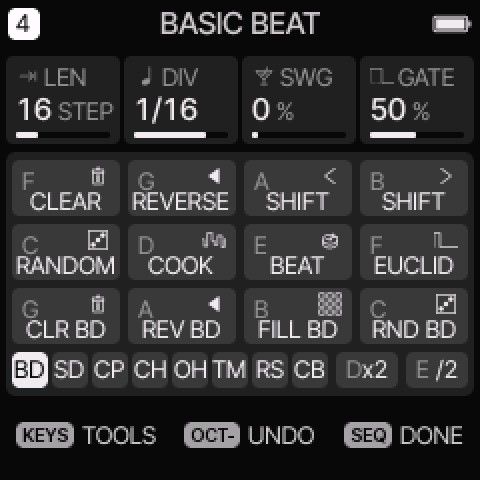<figcaption>Hold SEQ, then E4: "BASIC BEAT".</figcaption></figure>
<figure>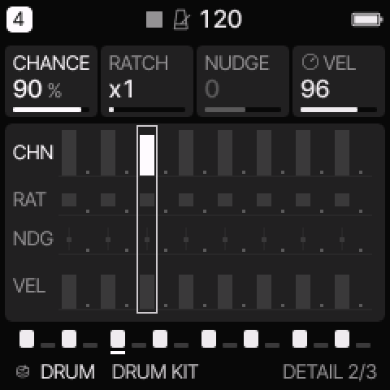<figcaption>DETAIL: step 5's CHANCE turned down. The CHN lane shows its bar.</figcaption></figure>
<figure>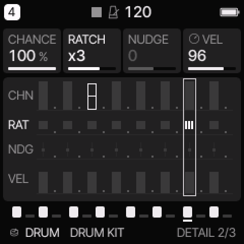<figcaption>Step 13 at RATCH ×3. The RAT lane shows three ticks.</figcaption></figure>

**Conditions** make a step play on a fixed loop instead of at random. Turn **KNOB 1 past 100 %**, and the card changes from CHANCE to **COND**:

| Condition | Plays |
|---|---|
| **1:2, 2:2** | on the 1st or the 2nd of every 2 loops |
| **1:3, 2:3, 3:3** | on one of every 3 loops |
| **1:4 … 4:4** | on one of every 4 loops. **4:4** = only the last bar of four, a classic fill spot |
| **FILL** | only while **FILL** is held (**hold GLO, press E4**) |
| **!FILL** | always, **except** while FILL is held. Use it to drop the hats out during a fill |

**Recipe: a fill on bar 4.** Put a few extra snare hits on steps 14–16, set them to **4:4**, and set a crash to **FILL** for live use.

<figure>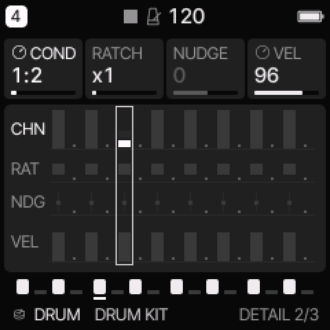<figcaption>Past 100 %: COND 1:2, every other loop.</figcaption></figure>
<figure>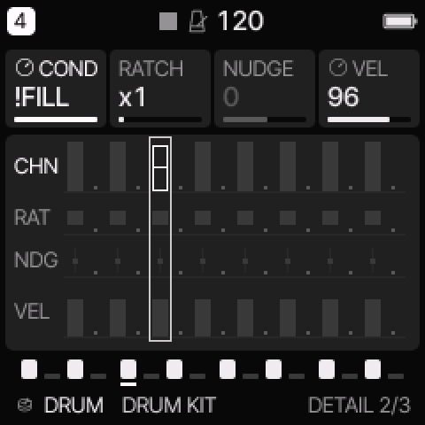<figcaption>!FILL: plays except during a fill.</figcaption></figure>
<figure>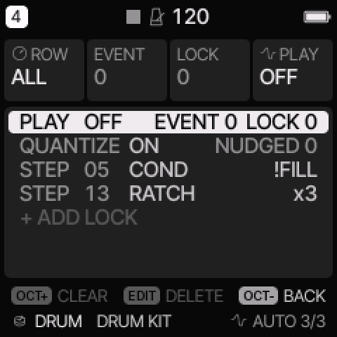<figcaption>SEQ → AUTOMATION lists all of it: step 5 COND !FILL, step 13 RATCH ×3.</figcaption></figure>

## 2. Parameter locks: a different sound on one step

A **lock** changes a sound parameter for **one step only**, and the next step goes back. That's how you get one open-sounding hat, one bright note, or one pitched-up snare.

**Which parameter a knob locks:** the one that knob controls on the **sound page you looked at last**, such as EDIT 1, ENV, LFO or FX. So **visit that page first**.

**Recipe: hi-hats with one short, choked hit.**
1. Track 4, tap **EDIT**. On a DRUM track this is KIT, TUNE, TONE, DECY: KNOB 4 is DECAY.
2. Tap **SEQ** for the drum grid. Turn **KNOB 2** to the **HATCL** lane.
3. **Hold the white key** of one hat step and turn **KNOB 4**. While you hold it, the cards show the EDIT page's four values, with the locked one bright.
4. Let go. The hit stays, and that step now has its own decay.

**On a synth track**, locks are made while step recording: arm REC on SEQ → STEP, hold the note's key, and turn a knob.

**To remove locks**, tap **EDIT** while holding the step, or delete the row in **SEQ → AUTOMATION** (EDIT deletes the selected row).

<figure>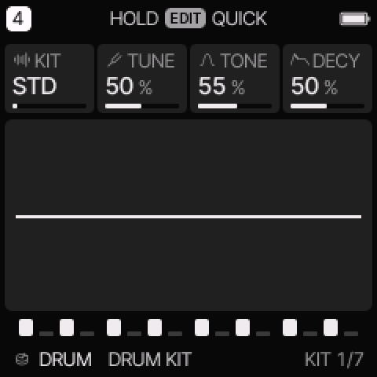<figcaption>Step 1: the page whose knobs you'll lock, EDIT 1 on a drum track.</figcaption></figure>
<figure><figcaption>Holding hat step 2 and turning KNOB 4: DECY 41 % on that step only.</figcaption></figure>
<figure>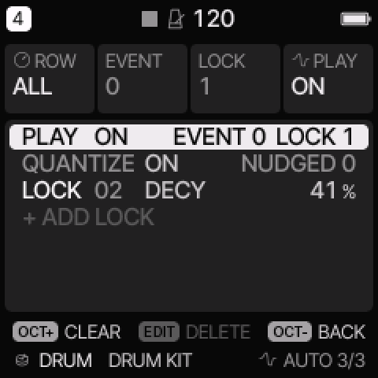<figcaption>AUTOMATION: "LOCK 02 DECY 41 %".</figcaption></figure>

## 3. Record your knob moves (automation)

Turn a knob while recording, and the sequencer plays the move back on every loop.

**Recipe: a filter sweep that repeats.**
1. Track 1 with a pattern playing. Tap **HOME**, where KNOB 1 is CUT.
2. Tap **REC** to arm the track (a dot after the track number), and slowly turn **KNOB 1** down and back up.
3. Tap **REC** to stop recording. The sweep keeps playing.
4. Look in **SEQ → AUTOMATION**: each move is an **AUTO** row (step, parameter, value). Turn its **PLAY** off to bypass it, or press **OCT+** for CLEAR.

**Automation or lock?** An **AUTO** event sets a value that **holds** until the next event. A **LOCK** applies to **one step** only. AUTOMATION can turn one into the other.

<figure>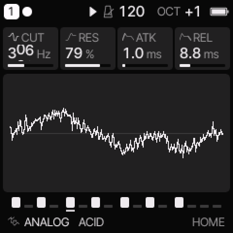<figcaption>Armed and playing: turning CUT records it.</figcaption></figure>
<figure>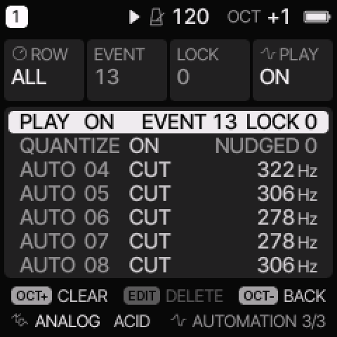<figcaption>The recorded sweep: AUTO 04–08, CUT 322 → 278 → 306 Hz.</figcaption></figure>

## 4. Generate rhythms: EUCLID, BEAT, RANDOM, COOK

**Hold SEQ** for SEQ TOOLS. The tools are on the keys:

| Key | Tool |
|---|---|
| **C4 RANDOM** | a new beat, or new notes in the scale on the same rhythm |
| **D4 COOK** | changes the pattern a little on each press |
| **E4 BEAT** | (drum track) a basic beat |
| **F4 EUCLID** | spreads N hits evenly over the steps |
| **D5 ×2 / E5 ÷2** | doubles the pattern, or keeps its first half |

**Recipe: a Euclidean rim pattern.** Keep **SEQ held** the whole time:
1. Track 4, hold **SEQ**, press **F4 (EUCLID)**.
2. Press the **black key** of the lane (the lane row at the bottom). **G♯4 = RS (rim)**.
3. **KNOB 1** sets HITS, **KNOB 2** STEPS and **KNOB 3** ROT (rotation). Try **3 hits over 16**, then 5, then 7.
4. Press **OCT+** to **apply** while SEQ is still held. Letting go of SEQ first cancels.

<figure>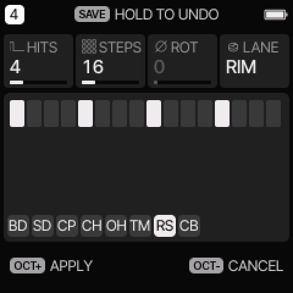<figcaption>EUCLID on the RIM lane: HITS, STEPS, ROT. OCT+ applies it.</figcaption></figure>
<figure>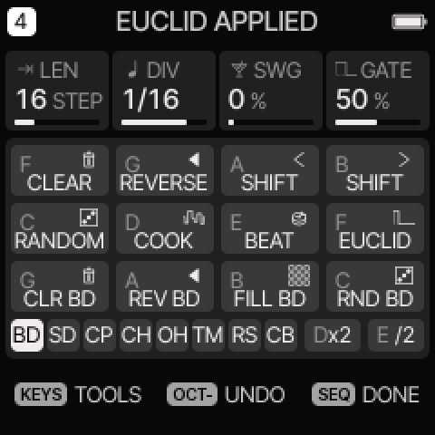<figcaption>"EUCLID APPLIED". Each tool is one undo.</figcaption></figure>
<figure>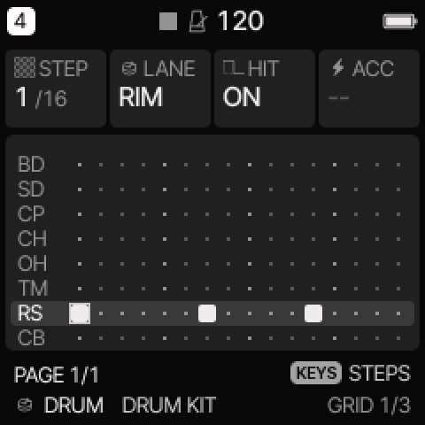<figcaption>The result: three rim hits spread over 16 steps.</figcaption></figure>

## 5. A wobble in time with the tempo (LFO sync)

1. Track 1 playing. Tap **LFO** for the **LFO** page: RATE, WAVE (SIN, TRI, SAW, SQR, S&H), PHS, FADE.
2. Tap **LFO** again for **LFO 2**. Turn **KNOB 1 (SYNC)** to a note value such as **1/8**. The LFO now follows the BPM.
3. Tap **LFO** again for **LFO DEST**. Turn **KNOB 2 (FLT)** up. The filter now wobbles in eighth notes.

Try WAVE **SQR** for a gated, choppy effect, or SYNC **1 bar** for a slow sweep.

<figure>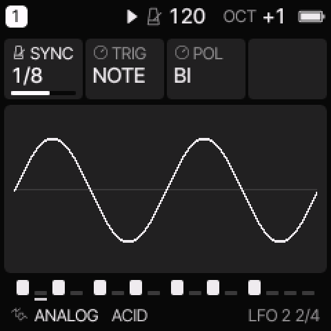<figcaption>LFO 2: SYNC 1/8, TRIG NOTE, POL BI.</figcaption></figure>
<figure>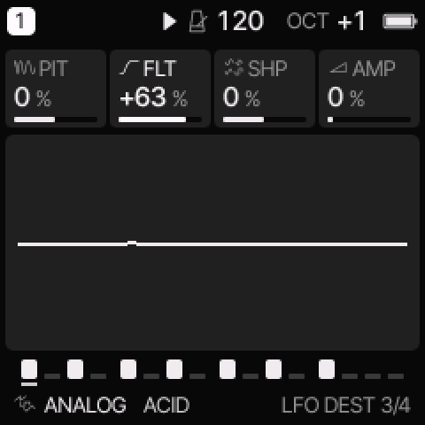<figcaption>LFO DEST: FLT +63 %, so the LFO moves the filter.</figcaption></figure>

## 6. A random filter on every note (MOD matrix)

**LFO**, tapped four times, opens **MOD**: 4 slots per track. **KNOB 1** is the slot, **KNOB 2** the source, **KNOB 3** the destination and **KNOB 4** the amount (+ or −).

- **Sources:** LFO, ENV, VEL, KEY, RAND, MODW (mod wheel), AT (aftertouch), EXPR, **S&H** and **SLEW**.
- **Destinations** include PITCH, CUT, SHP, AMP, PAN, DIST, the effect sends, RATE and **DEPTH** (the LFO itself).

**Recipe:** set slot 1 to **S&H → CUT** at about +60 %. Every LFO cycle picks a new random cutoff, the classic "computer burble". Make it **VEL → CUT** instead and harder notes play brighter.

<figure>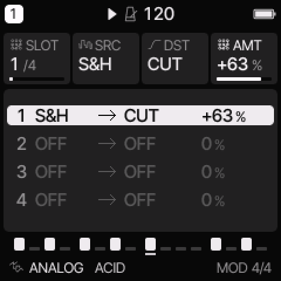<figcaption>MOD slot 1: S&H → CUT +63 %.</figcaption></figure>

## 7. One-finger chords and an arpeggio

1. Tap **SCL**: **KNOB 2 (SCL)** = **MIN** and **KNOB 3 (QNT)** = **WHITE**, so the white keys are now C minor.
2. Tap **SCL** again for **CHORD**: **KNOB 1 (CHRD)** = **DIA7**, the 7th chords of the scale. One key now plays a whole chord, such as Cm7. **KNOB 2 (VOIC)** spreads it: CLOSE, OPEN, INV1, INV2 or +OCT.
3. Tap **ARP**: **KNOB 1 (MODE)** = **UP** and **KNOB 2 (RATE)** = 1/16.
4. Tap **ARP** again for **ARP 2**: **KNOB 3 (HOLD)** = **ON**. Press one key and the arpeggio keeps going after you let go. Press another key to change chord.

Record it with **REC** (live) and you have a chord progression in one finger per bar.

<figure>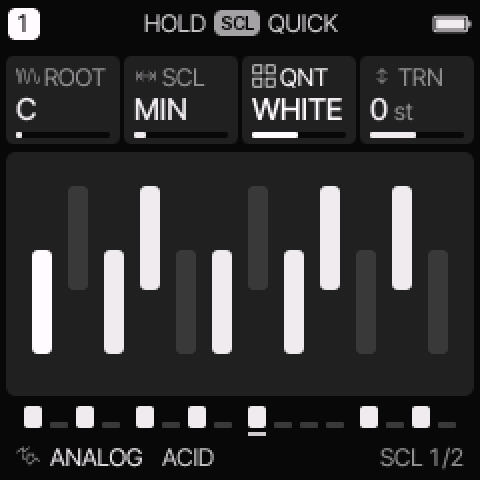<figcaption>SCL: MIN on the white keys.</figcaption></figure>
<figure>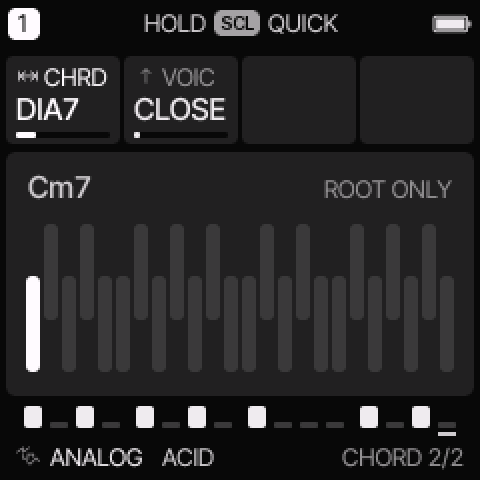<figcaption>CHORD: DIA7 means one key plays a 7th chord (here Cm7).</figcaption></figure>
<figure>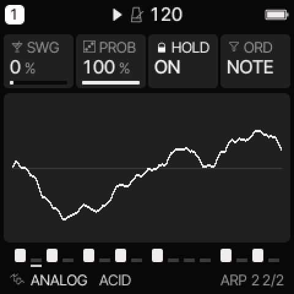<figcaption>ARP 2: HOLD ON keeps it running.</figcaption></figure>

## 8. Lo-fi grit: the INSERT effect

Each track has its own **INSERT**. Tap **FX** three times for it: FX, SLICER, then **INSERT**.
- **KNOB 1** picks the type: SOFT, HARD, FOLD, FUZZ (drives), **CRUSH** (bits and sample rate), PHASR, FLANG or CHOR.
- **KNOB 2–4** are its settings. For CRUSH they are BITS, RATE and LPF.
- **INSERT 2** (the next FX page) is the dry/wet **MIX**.

**Recipe:** CRUSH at **8–9 bits, 11 kHz** on the drum track gives an instant old-sampler sound. Lock **INSRT** to CRUSH on just one step (recipe 2) for a single crunchy hit.

<figure>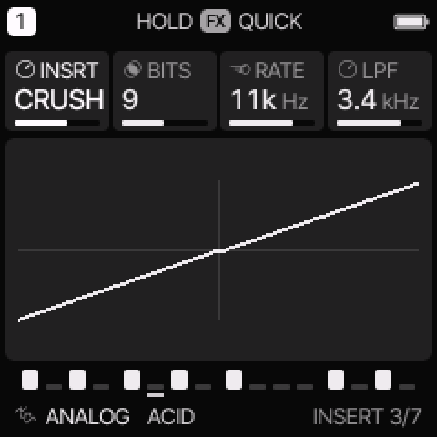<figcaption>INSERT: CRUSH, 9 bits, 11 kHz.</figcaption></figure>

## 9. Play it live

| Move | How |
|---|---|
| **Temporary tweak** | **Hold LFO** and turn any knob. Let go and the value jumps back. Press OCT+ while holding to keep it |
| **Effects on the keys** | **Hold FX**: repeat (1/8, 1/16, 1/32), reverse, LPF/HPF sweeps, tape STOP, FREEZE, OCT± harmonizer, flanger, phaser |
| **Reverb / echo throw** | Hold FX, then **D5 (VERB)** or **E5 (ECHO)**: every track's send goes fully up, and the tail rings out after |
| **Latch effects** | MENU → CONTROL → **FX LATCH ON**: an effect key toggles instead of needing to be held |
| **Mute and solo** | **Hold GLO**: the white keys F–B solo tracks 1–4, and the black keys mute them |
| **Fill** | Hold GLO, then **E4 (FILL)**: plays the FILL steps and drops the !FILL steps (recipe 1) |
| **Restart** | Hold GLO and press PLAY |

<figure>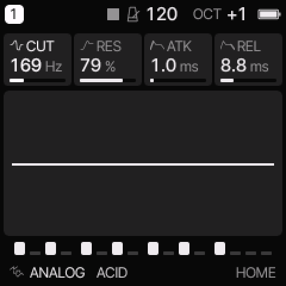<figcaption>Holding LFO, CUT turned down to 169 Hz…</figcaption></figure>
<figure>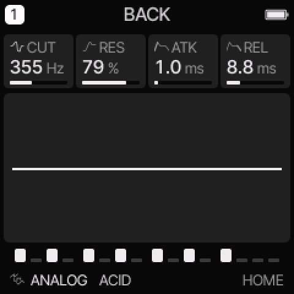<figcaption>…let go: "BACK" to 355 Hz.</figcaption></figure>

## 10. With a controller and a DAW

**MIDI LEARN: put any parameter on your controller's knobs.**
1. Hold **GLO** and press **D4**. The screen says "LEARN: TURN A KNOB".
2. Turn the FM-1 knob for the parameter, on any track. The screen says "T1 CUT: SEND A CC".
3. Move a knob or fader on your controller. That CC now controls the parameter. Repeat for up to 16.
4. Press **OCT+** to finish ("LEARN DONE"). Learned CCs are kept through power-off. **MENU → MIDI → LEARN CLEAR** removes them.

**Per-track MIDI channels** (MENU → **MIDI** tab):
- **MIDI IN CH1-4** (the default): channels 1–4 play tracks 1–4.
- **TRACK**: each track gets its own channel, set with **T1–T4 CHANNEL**.
- **AUTO SELECT**: the track an incoming note plays becomes the selected track.
- A **Program Change** on a track's channel loads that track's sound, numbered as in PRESETS.

**Record into a DAW over one USB cable** (from the manual):
- The FM-1 shows up as an audio input named **"Felucca"** at 44.1 or 48 kHz, with no driver.
- Set **MENU → AUDIO → USB LEVEL** to **FIXED** for a full-level recording, and **SPEAKER EQ** to **FLAT**.
- On macOS 13–15, set **MENU → SYSTEM → USB SERIAL** to OFF so the audio input appears.
- To sync with the DAW, set the clock source to USB on **HOME → CLOCK** (KNOB 3, CLK).

<figure>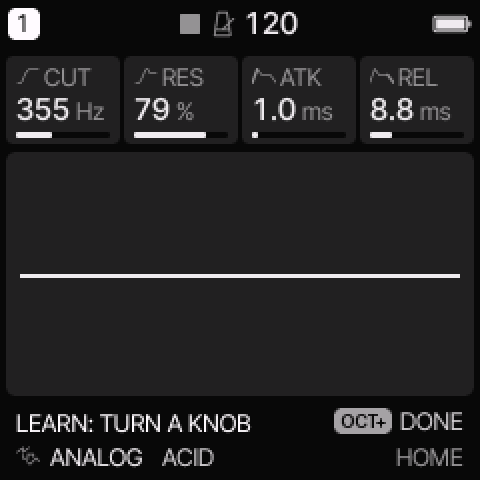<figcaption>GLO + D4: "LEARN: TURN A KNOB".</figcaption></figure>
<figure>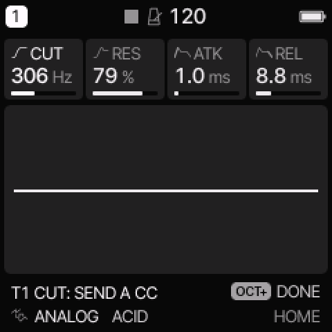<figcaption>KNOB 1 turned: "T1 CUT: SEND A CC".</figcaption></figure>
<figure>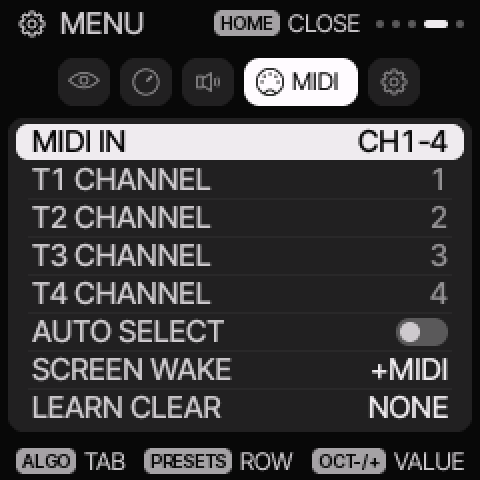<figcaption>MENU → MIDI: MIDI IN, T1–T4 CHANNEL, AUTO SELECT, SCREEN WAKE and LEARN CLEAR.</figcaption></figure>

## Where next

- **6-operator FM:** FM6 tracks can be edited on the device (EDIT → OPERATOR, OP ENV, OPERATOR 2), or load a whole DX7 .syx bank from the [web editor](https://hugelton.github.io/Felucca/webapp/editor/).
- **Your own samples** go into the SAMPLE, GRAIN and SLICE engines from the web editor.
- **The manual:** [Felucca wiki](https://github.com/hugelton/Felucca/wiki/Home), including [Menu](https://github.com/hugelton/Felucca/wiki/Menu) and [Engines](https://github.com/hugelton/Felucca/wiki/Engines).

---

<small>Not affiliated with M-VAVE or Hügelton Instruments. Felucca is GPL-3.0 software by Leo Kuroshita / Hügelton Instruments. The screenshots are of Felucca 1.6.1 running in its official browser version.</small>
