

[Felucca](https://github.com/hugelton/Felucca) by Hügelton Instruments is a free, open-source firmware for the FM-1. It turns the FM-1 into a **4-track synth and sequencer** with 13 sound engines. It can do a lot, and the panel's printed labels mean something else under Felucca, so this page walks you from "what do these buttons do" to a short song.

> **Version:** written for **Felucca 1.6.1**. The screenshots come from [Felucca in your browser](https://hugelton.github.io/Felucca/webapp/try/). It runs the same 1.6.1 firmware compiled for the web, so its screen is identical to your FM-1's. Each step was checked there and against the firmware source. Videos made for 1.0.x show an **older page layout**, because version 1.4 moved the pages around. The official reference manual is now in the [Felucca wiki](https://github.com/hugelton/Felucca/wiki/Home). If something here doesn't match your FM-1, please [open an issue](https://github.com/fuleo/fm1-guide/issues).

<figure><figcaption>The panel: four knobs on the left, KNOB 1–4 on the right, and the 12 buttons. The browser version draws the keys as two rows.</figcaption></figure>

## 1. Four rules that explain most of it

1. **Tap a button for its page, and tap it again for the next page.** HOME, for example, cycles through HOME → MIXER → CLOCK. The bottom-right corner of the screen shows where you are, such as "MIXER 1/2".
2. **Hold a button for its *layer*,** a temporary map of the keys and knobs. Let go and the layer closes. **Double-tap** the button to keep the layer open, and tap it again to close it.
3. **OCT+ means "OK, do it"** and **OCT− means "back / cancel"**. The bottom line of the screen always shows what they do on that page.
4. **Hold SAVE to undo** the last edit. Hold **HOME** for the menu.

| Knob | What it does |
|---|---|
| **ALGORITHM** | picks the **track** (1–4) you're working on. The number top-left on the screen is the track |
| **PRESETS** | changes the selected track's **sound** (on any page that isn't a list) |
| **SELECT** | the **tempo** (the default. MENU → CONTROL → SELECT can change what it does) |

<figure><figcaption><b>HOME:</b> track 1 at the top left, stopped, 120 BPM. The four cards are KNOB 1–4, and the bottom line shows the engine and the sound (ANALOG, ACID).</figcaption></figure>
<figure>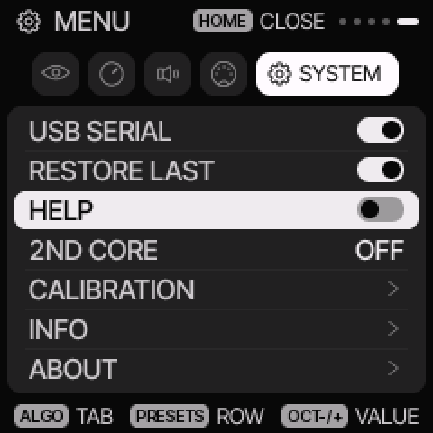<figcaption><b>Hold HOME</b> for the menu. ALGORITHM picks the tab, PRESETS the row, and OCT+/− the value.</figcaption></figure>

**Turn on the hints.** Hold **HOME**, turn **ALGORITHM** to the **SYSTEM** tab (the last one), turn **PRESETS** down to **HELP**, press **OCT+** to switch it on, then tap **HOME** to close. Each page now shows a short hint for two seconds when it opens.

## 2. The buttons

| Button | Tap cycles through | Hold |
|---|---|---|
| **HOME** | HOME, MIXER, CLOCK (BPM, swing, clock source) | the menu |
| **SEQ** | STEP (piano roll or drum grid), DETAIL, AUTOMATION | **SEQ TOOLS** (on every page) |
| **GLO** | SONG | solos, mutes, MIDI LEARN, FILL, TAP tempo |
| **SAVE** | USER, PRESETS, PHRASES, PROJECT, TOOLS | undo |
| **EDIT** | the sound pages of the track's engine | **pick an engine** |
| **ENV, LFO, ARP, SCL, FX** | their pages | FX and SCL: their layers. LFO: a temporary knob change |
| **REC** | arms the track for recording | the REC layer: CLEAR, CLICK, COUNT-IN |
| **PLAY** | start and stop | |

## 3. Your first sound

1. Turn **ALGORITHM** to **track 1**.
2. Turn **PRESETS** and play the keys. Each click is another factory sound.
3. To change the **engine**, **hold EDIT**. The keys turn into an engine map (ANLG, FM6, PHAS, LOFI, SMPL…), so press the key under the engine you want. **KNOB 2 (No.)** picks a sound of that engine. Let go of EDIT when you're done.
4. To browse sounds by **category** (BASS, LEAD, PAD, KEYS, DRUM…), tap **SAVE twice** for the **PRESETS** list. KNOB 2 there is the engine, and **KNOB 4 (LIST)** shows one category at a time.
5. To shape the sound, tap **EDIT** for its main knobs, **ENV** for attack, decay, sustain and release, and **FX** for the effect sends.

<figure>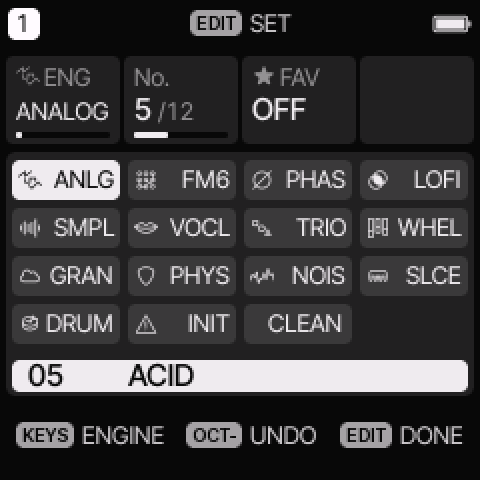<figcaption><b>Hold EDIT:</b> each key picks an engine. The cards show the engine, the sound number and FAV.</figcaption></figure>
<figure>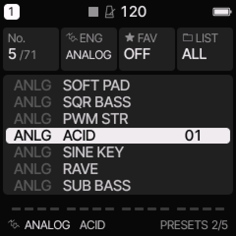<figcaption><b>SAVE, SAVE → PRESETS:</b> the sound list, with KNOB 4 (LIST) for categories.</figcaption></figure>
<figure>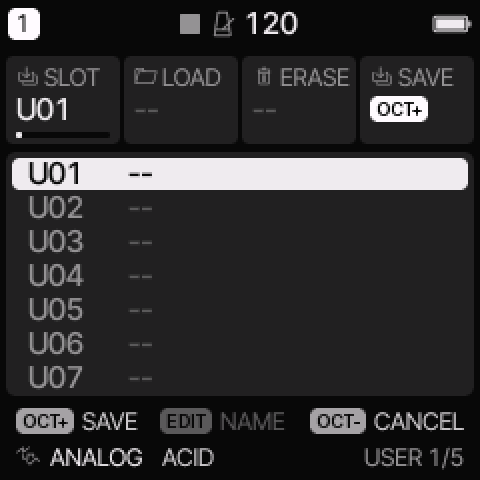<figcaption><b>SAVE once → USER:</b> 32 slots for your own sounds. OCT+ saves.</figcaption></figure>

**Save a sound you like:** stop playback, tap **SAVE** for the USER page, pick a slot with **KNOB 1**, then press **OCT+** and **OCT+** again. The second OCT+ is on the name screen, where the keys type a name if you want one.

## 4. Your first beat (drum track)

Track 4 starts on the **DRUM** engine (DRUM KIT). To change the kit, hold EDIT and turn KNOB 2.

1. Turn **ALGORITHM** to **track 4** and tap **SEQ** for the **drum grid**. Its rows are the 8 lanes: BD (kick), SD (snare), CP (clap), CH and OH (closed and open hat), TM (tom), RS (rim) and CB (cowbell). Its columns are the 16 steps.
2. Here the **16 white keys are the 16 steps**: the lowest white key is step 1. **KNOB 2 (LANE)** picks the lane, and it starts on **KICK**.
3. Press white keys **1, 5, 9 and 13** for a four-on-the-floor kick.
4. Turn **KNOB 2** one click to **SNARE** and press keys **5 and 13**.
5. Turn **KNOB 2** two more clicks to **HATCL** (closed hat) and press every other white key: 1, 3, 5 … 15.
6. Press **PLAY**.

<figure>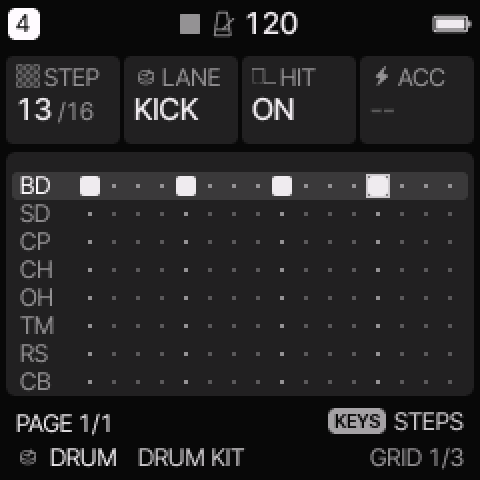<figcaption>Kick on steps 1, 5, 9 and 13.</figcaption></figure>
<figure><figcaption>Snare and closed hats added.</figcaption></figure>
<figure>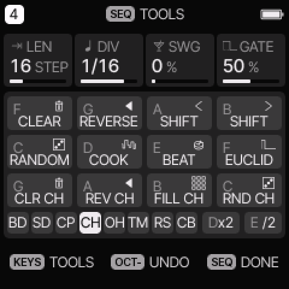<figcaption><b>Hold SEQ</b> on a drum track: BEAT, RANDOM, COOK, EUCLID and per-lane tools on the keys.</figcaption></figure>

**Cheat:** hold **SEQ** for **SEQ TOOLS**. Its keys include **BEAT**, which writes a beat for you, **RANDOM**, **COOK** (which changes the pattern a little on each press), **EUCLID**, and ×2 / ÷2 to double or halve. Each tool is one undo (hold SAVE).

## 5. Your first melody (synth track)

**Step recording** (easiest, one step at a time):
1. Turn **ALGORITHM** to **track 1** and tap **SEQ** for the **STEP** page, a piano roll. The box is the cursor.
2. **While stopped, tap REC.** A dot next to the track number shows it's armed.
3. Play a key or a chord. It's written into the step under the cursor, and **letting go moves the cursor on**.
4. **KNOB 1 (STEP)** moves the cursor, so you can skip a step to leave a rest.
5. On a step that holds a note, **KNOB 3 is its length (LEN)**. Turn it right to make the note last over the next steps.
6. Tap **REC** again to stop writing, then press **PLAY**.

<figure>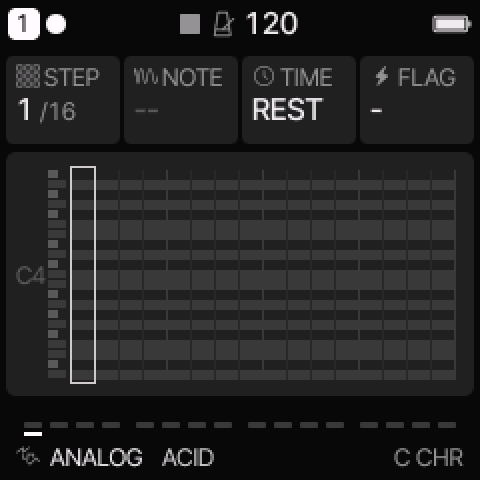<figcaption>SEQ → STEP with REC tapped while stopped. The dot after "1" means the keys now write steps.</figcaption></figure>
<figure>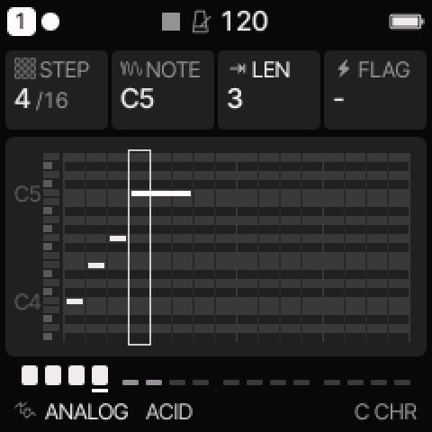<figcaption>Four notes written. On step 4, KNOB 3 (LEN) is set to 3, so the C5 lasts three steps.</figcaption></figure>

**Live recording** (play it in real time):
1. Tap **REC** to arm the track, then press **PLAY**. It loops, and each pass adds what you play (overdub).
2. For a click track and a count-in, **hold REC** for the REC layer. The keys and knobs set CLICK (OFF, REC or ON) and COUNT-IN (OFF, 1 BAR or 2 BARS).
3. Your timing is kept. **QUANTIZE** (on **SEQ → AUTOMATION**) set to **ON**, the default, plays everything on the grid, and **OFF** plays it exactly as you did.

**Too many wrong notes?** Tap **SCL**. **KNOB 2 (SCL)** picks the scale and **KNOB 3 (QNT)** set to **WHITE** makes the white keys play only notes of that scale.

**Pattern settings:** hold **SEQ** for SEQ TOOLS. KNOB 1 is **LEN**gth, KNOB 2 **DIV**ision, KNOB 3 **SWING** and KNOB 4 **GATE**.

<figure>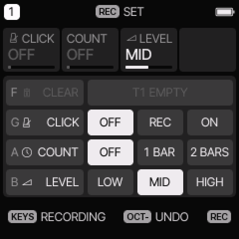<figcaption><b>Hold REC:</b> CLEAR, CLICK, COUNT-IN and click LEVEL.</figcaption></figure>
<figure>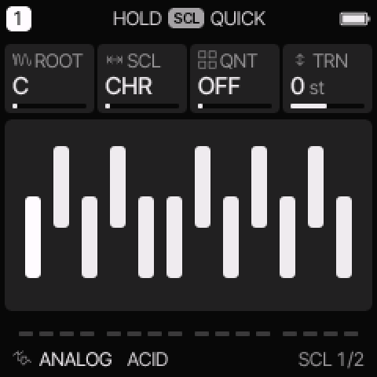<figcaption><b>SCL:</b> ROOT, SCL (scale), QNT and TRN (transpose).</figcaption></figure>
<figure>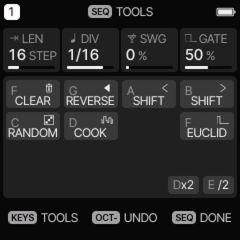<figcaption><b>Hold SEQ:</b> LEN, DIV, SWG and GATE on the knobs.</figcaption></figure>

## 6. Mix it

- Tap **HOME** twice for the **MIXER**. KNOB 1–4 are the selected track's level, pan, reverb send and mute, and the strip below shows all four tracks.
- To show all four tracks on the home screen, set MENU → DISPLAY → **HOME → LEVELS**. Then **KNOB 1–4 are the four track levels**.
- **Hold GLO** for quick **solos** (white keys) and **mutes** (black keys) while playing, plus TAP tempo.

<figure>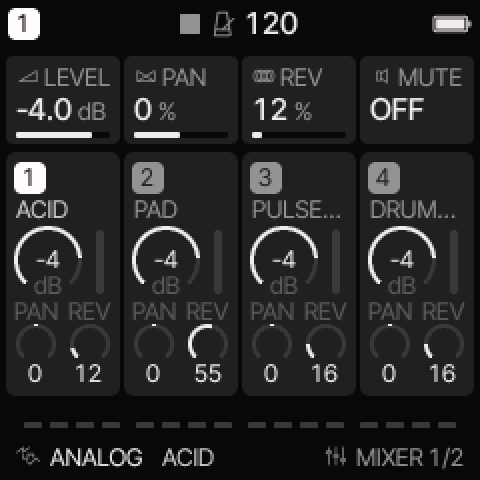<figcaption><b>HOME, HOME → MIXER.</b></figcaption></figure>
<figure>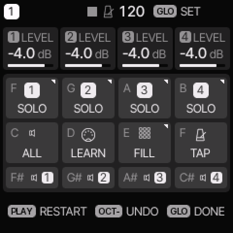<figcaption><b>Hold GLO:</b> SOLO 1–4, mutes on the black keys, LEARN, FILL and TAP.</figcaption></figure>

## 7. Save your work as a project

A **project** holds all four tracks: sounds, patterns and mix. There are four project slots, **A–D**.

1. **Stop** playback. Saving needs it, and otherwise the screen says "STOP TO SAVE".
2. Tap **SAVE** four times, for the **PROJECT** page.
3. Turn **KNOB 1** to choose the slot: 1 = A, 2 = B, 3 = C, 4 = D.
4. Turn **KNOB 4 (SAVE)** one click right, so it shows "OCT+", then press **OCT+**.
5. On the name screen, type a name with the keys or turn **KNOB 3** for a random one. Press **OCT+** to save. The slot now shows **USED**, and the header shows **"1 A"**: track 1 plays project A's pattern.
6. To **load**, use **KNOB 3 (LOAD)** the same way. **KNOB 2** erases a slot.

<figure>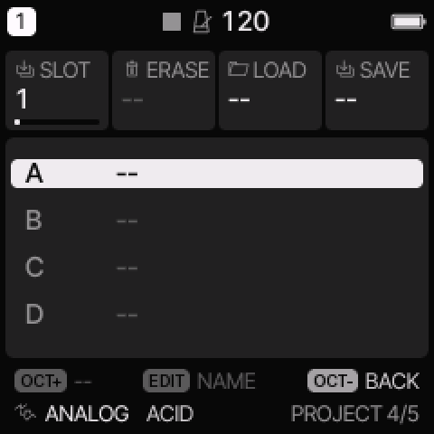<figcaption><b>SAVE ×4 → PROJECT:</b> SLOT, ERASE, LOAD and SAVE.</figcaption></figure>
<figure>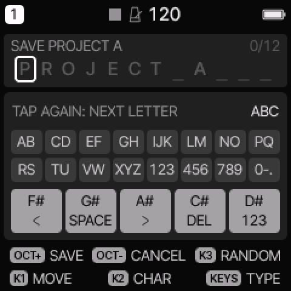<figcaption>The name screen: the keys type, KNOB 3 is RANDOM, and OCT+ saves.</figcaption></figure>
<figure>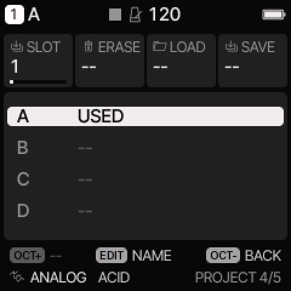<figcaption>Saved: slot A is USED, and the header shows "1 A".</figcaption></figure>

Your music also survives a power-off without saving: **MENU → RESTORE LAST** is on by default.

## 8. Make a song

A song is a list of up to **16 sections**. Each section says which **project slot's pattern** each track plays (A–D, or "-" to rest that track), and how many times it repeats. The song uses **the sounds you have now**.

**Get the patterns ready:**
1. Make a verse: drums, bass and a chord part. **Save it as project A** (section 7).
2. Change the patterns for a chorus, for example busier drums and a new melody. **Save it as project B**.

**Arrange them:** tap **GLO** for the **SONG** page.
- **KNOB 1** picks a **section**, **KNOB 2** a **track**, **KNOB 3 (PAT)** the slot it plays (**A–D or -**) and **KNOB 4** the **REPS**.
- The white keys **A3, B3, C4 and D4** (the 3rd to 6th white keys) set the selected cell to slot A, B, C or D. They don't make a sound on this page.
- Past the last section is **"+"**, for adding a section. Press one of those keys there, or turn **KNOB 3**, to add one copied from the section before.
- Press **PLAY** (or OCT+) on the SONG page to play the **song** from the start. PLAY on other pages plays only the current patterns. To edit the song, stop it first.

Try this: section 1 is all tracks on **A**. Section 2 is the same, with track 2 on **"-"** (a breakdown). Section 3 has track 2 on **B**, ×2.

<figure>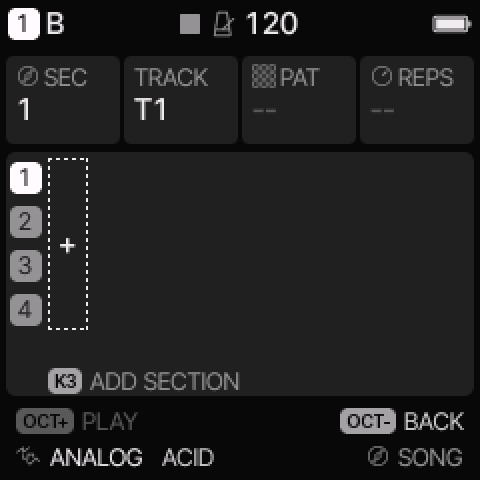<figcaption><b>GLO → SONG</b> on a new project: "K3 ADD SECTION".</figcaption></figure>
<figure>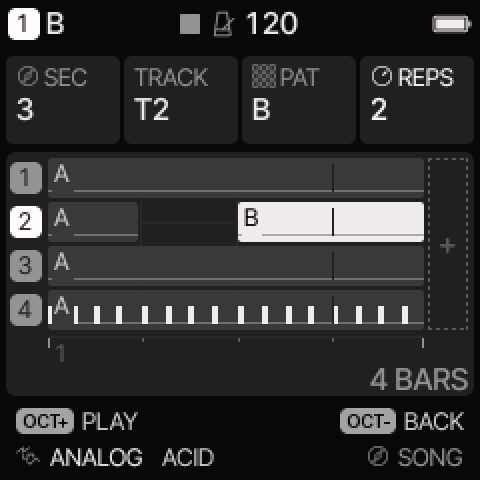<figcaption>Three sections: lanes 1–4 are the tracks. Track 2 rests in section 2 and plays B in section 3.</figcaption></figure>
<figure>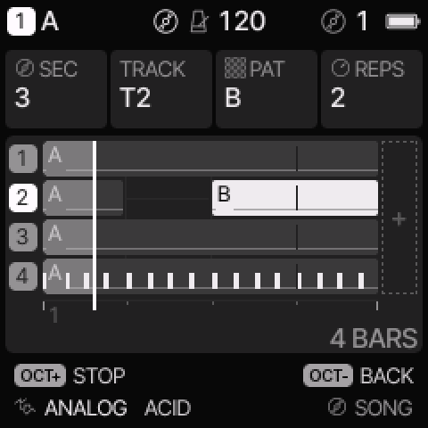<figcaption>Playing: the line is the play position. OCT+ now stops.</figcaption></figure>

## 9. Effects worth knowing

| Do this | You get |
|---|---|
| Tap **FX** six times for **REVERB**, TYPE **HALL** | a smooth reverb that rings for up to about 4.5 s. It's the default on a fresh start |
| **Hold FX** | live effects on the keys: repeat, reverse, filter sweeps, tape stop, freeze, flanger, phaser |
| Hold FX, then **D5 / E5** | **VERB / ECHO throws**: every track's reverb or delay fully up while held, and the tail rings out after |
| Double-tap **FX** | keeps the FX layer open, so both hands are free |
| In the FX layer, hold a white key and turn **PRESETS** | puts any of the effects on that key |
| **Hold LFO** and turn a knob | a temporary change: let go of LFO and the value jumps back |

<figure>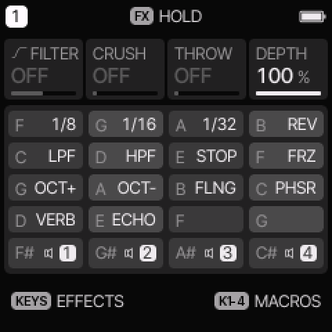<figcaption><b>Hold FX:</b> the effects on the keys, with VERB and ECHO on the high D and E.</figcaption></figure>
<figure>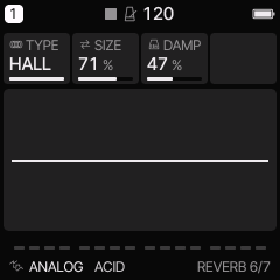<figcaption><b>FX page 6/7, REVERB:</b> TYPE HALL, SIZE and DAMP.</figcaption></figure>

## 10. Next steps

- **SEQ → DETAIL** (tap SEQ twice) puts the cursor step's **CHANCE**, **RATCHET** (×2–×4 repeats), **NUDGE** and **VELOCITY** on KNOB 1–4. Since 1.6, turning CHANCE past 100 % gives **conditions** such as 1:4 (every 4th loop) and FILL (only while FILL is held in the GLO layer).
- **Parameter locks:** on SEQ → STEP, hold a step and turn a knob to change that parameter on that one step only. **SEQ → AUTOMATION** lists everything like this.
- **The web editor** ([hugelton.github.io/Felucca/webapp/editor](https://hugelton.github.io/Felucca/webapp/editor/), Chrome or Edge over USB) edits every parameter, makes **full backups**, sets your own UI colours, and loads your own samples and DX7 .syx banks.
- **The manual:** the [Felucca wiki](https://github.com/hugelton/Felucca/wiki/Home) has Controls, Menu, Engines and Troubleshooting, and the [release notes](https://github.com/hugelton/Felucca/releases) explain each feature in detail.

## Going back to stock

The [web installer](https://hugelton.github.io/Felucca/) has **Return to official V15**. From Linux, see [Updating from Linux](linux-update.html). Projects made in Felucca stay in Felucca's own storage and don't carry over to the stock firmware.

---

<small>Not affiliated with M-VAVE or Hügelton Instruments. Felucca is GPL-3.0 software by Leo Kuroshita / Hügelton Instruments. The screenshots are of Felucca 1.6.1 running in its official browser version.</small>
