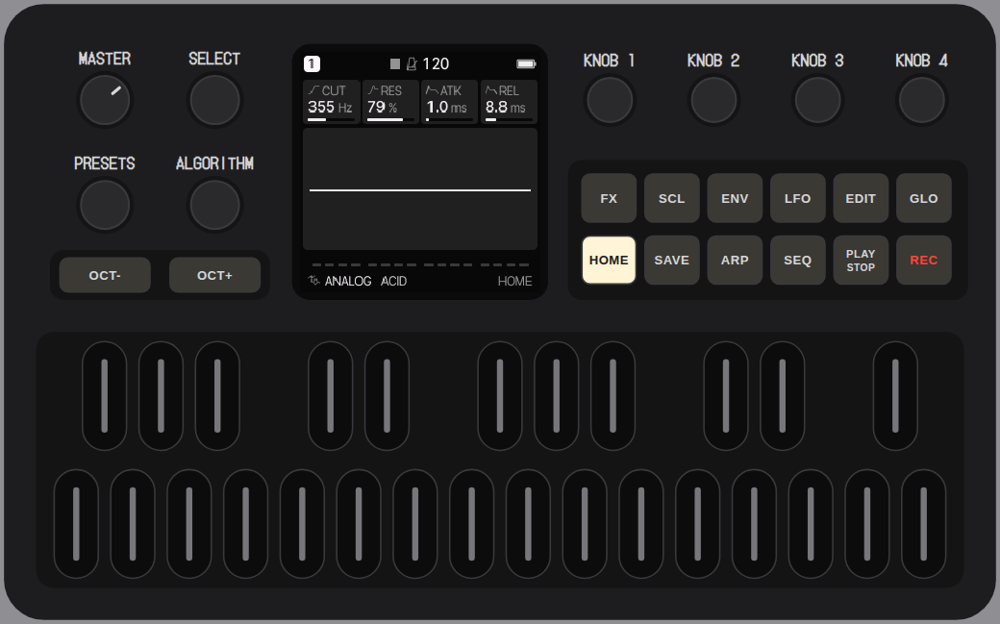
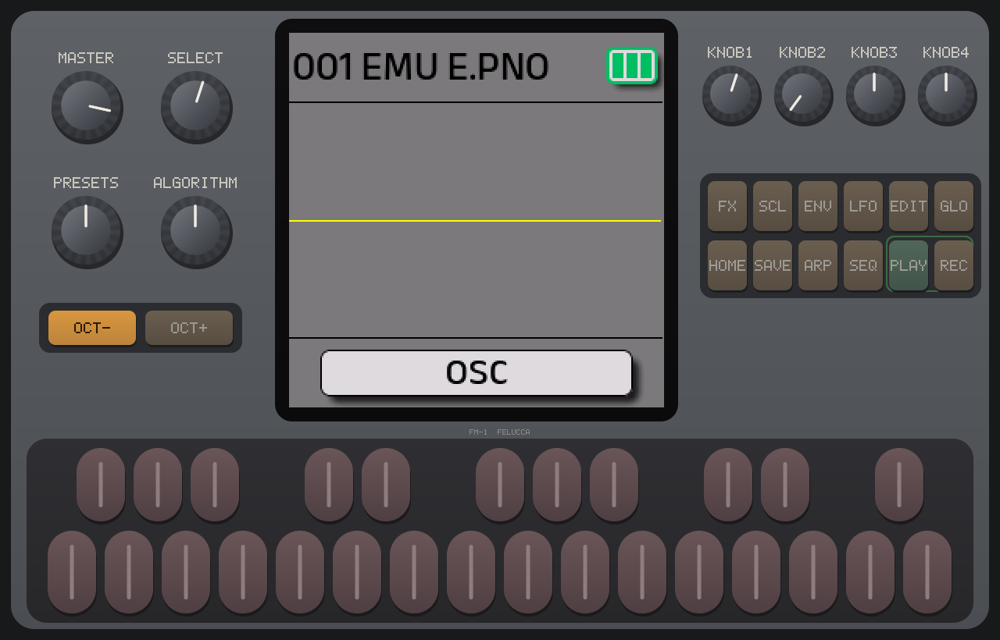
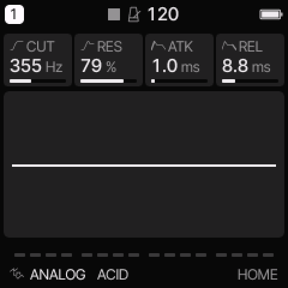
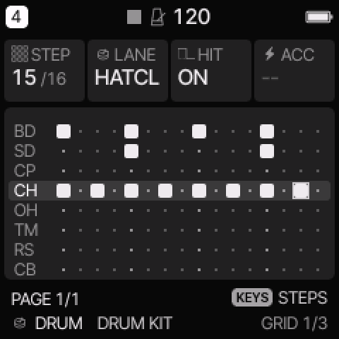
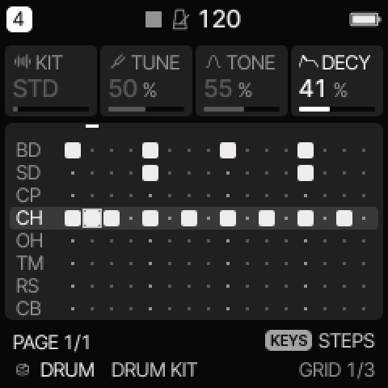

Practical, tested guides for the **M-VAVE FM-1** pocket synth. They cover the free **Felucca** firmware, the stock firmware, and updating it all from **Linux**. Every step was tried on a real FM-1 or in an emulator running the real firmware, and the screenshots are real screens.

<figure class="hero"><figcaption>The FM-1 running Felucca 1.6.1: four knobs on the left, KNOB 1–4 on the right, 12 buttons and 27 keys.</figcaption></figure>

## Try an FM-1 in your browser

<a class="card" href="https://joakimeriksson.github.io/fm1-emu/?fw=felucca&amp;mhz=100" style="text-decoration:none;color:inherit"><h3>fm1-emu: the whole FM-1, emulated →</h3>
Joakim Eriksson's emulator of the FM-1's chip runs the <b>real firmware files unchanged</b>: Felucca, SLOOP, X0X and more, or M-VAVE's own V15 if you open its <code>FM-1.fwsc</code>. Keys, knobs, sound and MIDI in. The link starts Felucca at 100 MHz; raise the clock if your computer keeps up.
</a>
<a class="card" href="https://hugelton.github.io/Felucca/webapp/try/" style="text-decoration:none;color:inherit"><h3>Felucca in your browser →</h3>
Felucca's own browser version: the same firmware compiled for the web, with the panel on screen. The screenshots in the Felucca tutorials come from it.
</a>

## Felucca (custom firmware, free)

[Felucca](https://github.com/hugelton/Felucca) by Hügelton Instruments turns the FM-1 into a **4-track synth and sequencer** with 13 sound engines, songs, effects and MIDI. These guides are written for **1.6.1**.

<a class="card" href="felucca.html" style="text-decoration:none;color:inherit"><h3>Felucca for beginners →</h3>
The four rules behind the buttons, then a first sound, beat and melody, mixing, saving projects, and building a song with a lane per track. 24 screenshots.
</a>
<a class="card" href="felucca-advanced.html" style="text-decoration:none;color:inherit"><h3>Felucca advanced →</h3>
Ten recipes: chance and conditions, ratchets, parameter locks, recorded knob moves, EUCLID, synced LFOs, the MOD matrix, chords and arps, INSERT effects, live play, MIDI LEARN and DAW use.
</a>

**Install:** use the [web installer](https://hugelton.github.io/Felucca/) in Chrome or Edge over USB, or [from Linux](linux-update.html#custom-firmware). You can also [try it in your browser](https://hugelton.github.io/Felucca/webapp/try/) without an FM-1.

## Stock firmware (M-VAVE V15)

<a class="card" href="sequencer.html" style="text-decoration:none;color:inherit"><h3>Using the stock sequencer →</h3>
Record patterns, long notes, pattern length, Chain and voice binding, plus a 3-pattern song to build.
</a>
<a class="card" href="reverb.html" style="text-decoration:none;color:inherit"><h3>Getting the long reverb back →</h3>
Why the reverb tail seems to vanish after V15, and the measurements that show it (decay 100 ≈ the old fade).
</a>
<a class="card" href="linux-update.html" style="text-decoration:none;color:inherit"><h3>Updating from Linux →</h3>
V14 → V15 with no Windows or macOS app: verify the file, send it over USB-MIDI, and check the result.
</a>

<b>What V15 changed (2026-07-30)</b>

From M-VAVE's own release note, linked from [m-vave.com/download](https://www.m-vave.com/download):

| Area | Change |
|---|---|
| Display | Brighter base LED backlight |
| Global | **Voice reset** per bank (A–D); **Glide** 0–1 s (mono voices only, GLOB page 2) |
| Sequencer | **Long notes**, **Step** count, **Chain** 1–16 (SEQ page 1); **voice binding** per pattern (SEQ page 2) |
| Edit | **Init voice**, **rename**, **copy & replace** (EDIT → GLOBE sub-page, page 2: K1 / K2 / K3); long-press an **OP** button to mute it |
| FX & ENV | Ranges went from 0–10 to **0–100**. Old values are not converted, see [the reverb page](reverb.html) |
| MIDI | Note-on with velocity 0 now counts as note-off. Effect CCs use the 0–100 scale |

Earlier versions:
- **V13** (2026-07-03):
  - ARP and the sequencer sync to the BPM.
  - The sequencer can transpose.
  - Global velocity setting.
  - The MIDI channel defaults to ALL.
  - Program Change selects voices.
  - ARP rates 1/1 and 1/2 added.
- **V09** (2026-06-24):
  - ENV on/off switch.
  - Rests and note replacement in the sequencer.

## The custom firmware scene

The FM-1's update path is open, so more than 30 community firmwares appeared in October 2026. The best known, as of **16 October 2026**:

| Firmware | Latest | What it is | Source |
|---|---|---|---|
| [SLOOP](https://github.com/isod89/sloop-fm1) | 2.7 | live 4-track groovebox (3 synths + drums), built on Felucca | open, GPL-3.0 |
| [Felucca](https://github.com/hugelton/Felucca) | 1.6.1 | multi-engine 4-track synth and sequencer, the base of most others | open, GPL-3.0 |
| [X0X](https://github.com/charlesvestal/fm1-x0x) | 1.1.0 | 909, 808 and two 303s, ReBirth-style | open, GPL-3.0 |
| [Melodee](https://github.com/keremimo/melodee) | 1.4.1 | Felucca-family synth | open |
| [FoMni](https://github.com/charlesvestal/fm1-fomni) | 0.4 | Omnichord-style: strum the white keys, chords on the black | open, GPL-3.0 |
| [Jangada](https://github.com/zednaked/jangada) | 1.0 | virtual-analog synth with a mod matrix and drones | open, GPL-3.0 |
| [zp12](https://github.com/zvenson/zp12) | 2.1 | SP-12-style sampling drum machine | open, GPL-3.0 |
| [Baud Girl FM-1+VA](https://baudgirl.com/work/FM-1+VA) | 101 | the stock FM sound plus a virtual-analog engine and a 64-step sequencer | closed (free) |
| Groove OS | – | 8-track groovebox | closed (paid) |

All of them install over USB with no tools to open the case. To go back, use M-VAVE's updater or the installer's "Return to official V15". The same chip is in the **SMK-37 Pro** keyboard, and ports for it have started to appear (Snoop37, X0X37, FoMni37, Baud Girl SMK-37+VA).

---

<small>Not affiliated with M-VAVE, Baud Girl or Hügelton Instruments. M-VAVE and FM-1 are trademarks of their owners. Felucca screenshots come from its official GPL-3.0 browser version. Corrections welcome via [issues](https://github.com/fuleo/fm1-guide/issues).</small>
