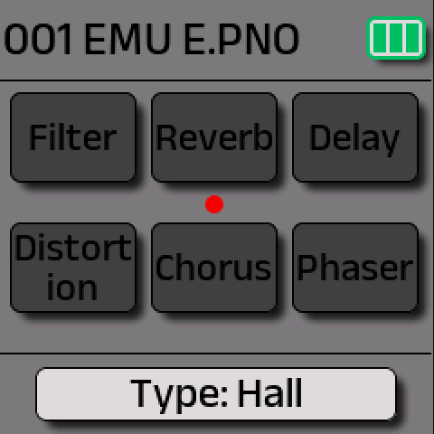
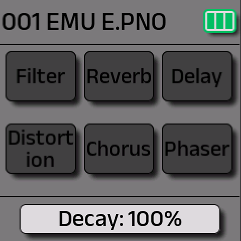
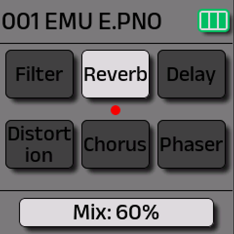

<style>
.shots{display:flex;flex-wrap:wrap;gap:12px;margin:12px 0 18px}
.shots figure{margin:0;flex:0 1 228px}
.shots img{width:228px;max-width:100%;height:auto;border-radius:10px;display:block}
.shots figcaption{font-size:.85em;color:#666;margin-top:4px;line-height:1.3}
.fix{border-left:4px solid #2a9d5c;background:#f1fbf5;padding:10px 14px;margin:14px 0}
.chart{max-width:640px;margin:10px 0 4px}
.chart .row{display:flex;align-items:center;gap:8px;margin:3px 0;font-size:.85em}
.chart .lbl{flex:0 0 120px;text-align:right;color:#444}
.chart .bar{height:18px;border-radius:4px;background:#9fd3ff}
.chart .bar.hi{background:#2a9d5c}
.chart .val{color:#333;white-space:nowrap}
</style>

**The symptom:** after updating from V14 to V15, the reverb's long fade-out seems to be gone.

**The cause:** V15 changed effect (and envelope) values from a **0–10** scale to **0–100**, and kept the stored numbers as they were. A decay of 8, near the top on V14, is now 8 out of 100, and that rings for about half a second.

<div class="fix"><b>The fix:</b> set reverb <b>Decay to 80–100 %</b>. On our FM-1, decay 100 brought the long fade straight back: about 5 seconds to fade by 40 dB, and around 7 seconds to silence.</div>

## On the synth

The screenshots are **stock V15** running in [fm1-emu](https://joakimeriksson.github.io/fm1-emu/), an emulator of the FM-1's chip that runs M-VAVE's own update file unchanged. The screens are the real firmware's. The patch name "EMU E.PNO" is the emulator's own, because update files carry no patches.

1. Press **FX**. The six effects are shown as boxes: a **bright box is on**, a **dim box is off**.
2. Turn **SELECT** until the **red dot** is under **Reverb**. The bottom bar shows its type.
3. **KNOB 1: Type**. Choose Room, **Hall** or Plate.
4. **KNOB 2: Decay**. Turn it up to **100 %**, in 1 % steps.
5. **KNOB 3: Mix**. Around **50–70 %** sounds natural for pads.
6. **KNOB 4: On/off**. Turn it right, and the Reverb box goes bright.
7. Press **FX** to leave, and **hold SAVE** to keep the setting in the sound.

<div class="shots">
<figure><figcaption>Steps 2–3: the dot under Reverb, KNOB 1 → <b>Type: Hall</b>.</figcaption></figure>
<figure><figcaption>Step 4: KNOB 2 → <b>Decay: 100%</b>.</figcaption></figure>
<figure><figcaption>Steps 5–6: <b>Mix: 60%</b>, then KNOB 4 → the Reverb box is <b>bright = on</b>.</figcaption></figure>
</div>

> **Note:** M-VAVE's printed manual lists Decay in 10 % steps and doesn't say which knob is which in V15. The order above (Type, Decay, Mix, On) is what V15 actually shows.

## Over MIDI

Send these on the **Effect Channel** (default **channel 2**). The values follow Baud Girl's [FM-1 MIDI guide](https://m-vave-fm1-midi-guide.up.railway.app/) and M-VAVE's CC table. We tested them with the script below.

| CC | Reverb parameter | Values |
|---|---|---|
| 4 | On/off | 0 off, anything else on |
| 5 | Type | 0 Room, 1 Hall, 2 Plate |
| 6 | Decay | 0–100 |
| 7 | Mix | 0–100 |

**CC 7 is reverb mix, not volume.** If a DAW sends CC 7 for track volume on channel 2, it changes the reverb mix instead.

For example, with `amidi` on Linux (port from `amidi -l`): reverb on, Hall, decay 100, mix 60:

```bash
amidi -p hw:FM1 -S 'B1 04 7F  B1 05 01  B1 06 64  B1 07 3C'
```

`B1` is a Control Change on channel 2. `64` hex is 100 and `3C` is 60.

## How long the tail lasts (measured, V15)

This is one FM-1 recorded over its own USB audio:
- The reverb was set by CC at mix 60.
- A 300 ms C4 was played at velocity 110.
- The bars show how long the sound takes to fall **40 dB** after the key is released.

<div class="chart">
<div class="row"><span class="lbl">Reverb off</span><span class="bar" style="width:1.1%"></span><span class="val">0.08 s</span></div>
<div class="row"><span class="lbl">Hall, decay 5</span><span class="bar" style="width:5.7%"></span><span class="val">0.40 s</span></div>
<div class="row"><span class="lbl">Hall, decay 8</span><span class="bar" style="width:7.1%"></span><span class="val">0.50 s ← old V14 "8"</span></div>
<div class="row"><span class="lbl">Hall, decay 10</span><span class="bar" style="width:10.3%"></span><span class="val">0.72 s</span></div>
<div class="row"><span class="lbl">Hall, decay 25</span><span class="bar" style="width:21.4%"></span><span class="val">1.5 s</span></div>
<div class="row"><span class="lbl">Hall, decay 50</span><span class="bar" style="width:32.9%"></span><span class="val">2.3 s</span></div>
<div class="row"><span class="lbl">Hall, decay 75</span><span class="bar" style="width:52.9%"></span><span class="val">3.7 s</span></div>
<div class="row"><span class="lbl"><b>Hall, decay 100</b></span><span class="bar hi" style="width:71.4%"></span><span class="val"><b>≈ 5 s</b> (silent ≈ 7 s)</span></div>
<div class="row"><span class="lbl">Room, decay 100</span><span class="bar" style="width:52.9%"></span><span class="val">3.7 s</span></div>
<div class="row"><span class="lbl">Plate, decay 100</span><span class="bar" style="width:61.4%"></span><span class="val">4.3 s</span></div>
</div>
<small>The bar length is the time to fall 40 dB, on a scale of 0–7 s.</small>

**Which type?** **Hall** has the longest tail, **Plate** is brighter and a little shorter, and **Room** is the shortest even at 100.

**The envelopes changed scale too.** If old V14 sounds feel shorter or snappier, open **ENV** and raise attack and release.

## Measure it yourself (Linux)

The FM-1 shows up as a USB audio device. Its capture format is 24-bit packed (S24_3LE), stereo, 44.1 kHz, so record through ALSA's converting device:

```bash
ffmpeg -f alsa -sample_rate 44100 -channels 2 -i plughw:FM1 -c:a pcm_s16le -t 7 take.wav
```

`hw:FM1` fails, because ffmpeg can't open the 3-byte format directly. The sweep script [`reverb_sweep.py`](https://github.com/fuleo/fm1-linux-update/blob/main/reverb_sweep.py) sets the reverb by CC, plays a note, records it and times the tail.

## Notes

- **Battery:** on battery, a loud held high note with a long reverb can make the battery bar drop briefly. That's most likely the voltage dipping under the speaker's load. Check whether it recovers after a minute of silence.
- **Custom firmware:** [Felucca](felucca.html#9-effects-worth-knowing) has its own reverbs (HALL up to about 4.5 s, ROOM, SPRING) and doesn't use these settings.

---

<small>Not affiliated with M-VAVE. Screens of M-VAVE's V15 firmware, shown running in fm1-emu (MIT) by Joakim Eriksson, for documentation. Measurements are ours.</small>
