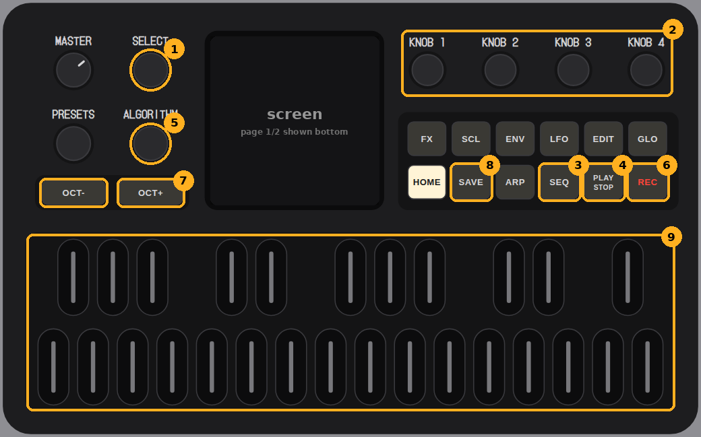
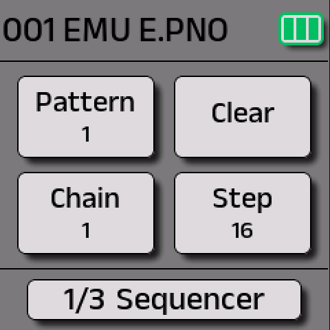
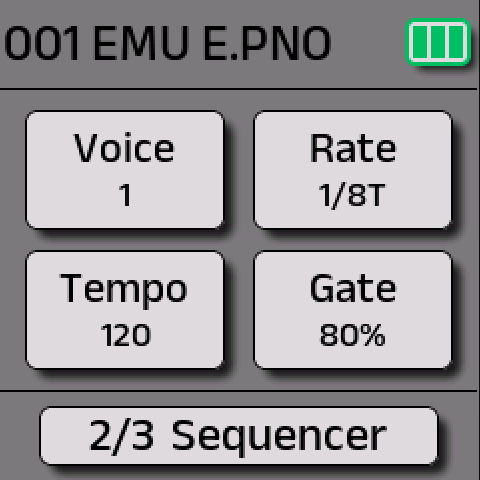
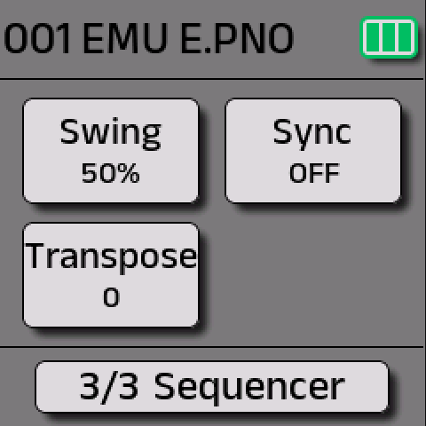
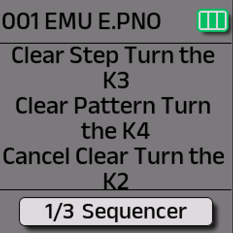

This page is for the **stock M-VAVE firmware (V15)**: 16 patterns of 16 steps, with long notes, pattern length, **Chain** and **voice binding** added in V15. It starts with a two-minute quick start, then each feature, then a 3-part song.

<b>Running Felucca instead?</b> Its sequencer works completely differently (4 tracks, 64 steps). See <a href="felucca.html">Felucca for beginners</a> and <a href="felucca-advanced.html">Felucca advanced</a>.

> **Sources:** the V15 screens in [fm1-emu](https://joakimeriksson.github.io/fm1-emu/), M-VAVE's [user manual](https://manuals.plus/m-vave/fm-1-fm-synthesizer-manual) for the controls, M-VAVE's V15 release note for the V15 features, and M-VAVE's MIDI guide for clock sync. One shortcut comes only from owners and is marked as such. If your FM-1 behaves differently, please [open an issue](https://github.com/fuleo/fm1-guide/issues).

## The controls you use

<figure class="fig"><figcaption>The sequencer's controls (panel drawing from Felucca's browser version; the screen is left blank).</figcaption></figure>

| # | Control | In the sequencer |
|---|---|---|
| 1 | **SELECT** | switches between the SEQ pages: page **1/2** and **2/2** are shown at the bottom of the screen. While you hold a key during recording, it sets the end of a long note |
| 2 | **KNOB 1–4** | the four settings of the current page (table below) |
| 3 | **SEQ** | turns the sequencer on or off. The keys then show the 16 steps: lit = has notes, blinking = playing now |
| 4 | **PLAY/STOP** | starts and stops the pattern |
| 5 | **ALGORITHM** | hold **OCT−** or **OCT+** and turn it to **transpose** −12 to +12 semitones, also while playing (SEQ page 3 also has Transpose) |
| 6 | **REC** | starts and stops recording: each key you press goes into the **next step** |
| 7 | **OCT− / OCT+** | octave down or up. Press **both** to reset octave and transpose |
| 8 | **SAVE** | **hold it** to store your patterns, sounds and settings in flash |
| 9 | **Keys** | play notes into the steps |

**The SEQ pages in V15** (three of them: turn SELECT, and the bottom bar shows 1/3, 2/3 or 3/3). Each card on the screen is the knob in the same place: top-left KNOB 1, top-right KNOB 2, bottom-left KNOB 3, bottom-right KNOB 4.

| Page | KNOB 1 | KNOB 2 | KNOB 3 | KNOB 4 |
|---|---|---|---|---|
| **1/3** | **Pattern** (1–16) | **Clear** (opens a menu) | **Chain** (1–16) | **Step** (pattern length) |
| **2/3** | **Voice** (the bound sound) | **Rate** (1/16, 1/8T…) | **Tempo** (BPM) | **Gate** (%) |
| **3/3** | **Swing** (50 %+) | **Sync** (follow MIDI Clock: OFF/ON) | **Transpose** | – |

<figure><figcaption><b>1/3:</b> Pattern, Clear, Chain, Step.</figcaption></figure>
<figure><figcaption><b>2/3:</b> Voice, Rate, Tempo, Gate.</figcaption></figure>
<figure><figcaption><b>3/3:</b> Swing, Sync, Transpose.</figcaption></figure>
<figure><figcaption><b>KNOB 2 (Clear)</b> asks first: turn KNOB 3 to clear the step, KNOB 4 to clear the pattern, or KNOB 2 to cancel.</figcaption></figure>

<small>Screens of stock V15 running in [fm1-emu](https://joakimeriksson.github.io/fm1-emu/), which runs M-VAVE's own update file. "EMU E.PNO" is the emulator's stand-in patch. M-VAVE's printed manual shows the older 2-page layout.</small>

**ARP and SEQ can't be on together.** Pressing SEQ while the arpeggiator is on shows "Disable ARP to enter". Press ARP to turn it off first, and the same goes the other way round.

## Quick start: your first pattern

1. Press **SEQ**. The SEQ LED and the STOP LED light up.
2. Turn **KNOB 1** to pick a **Pattern**, for example 1.
3. To start from empty, turn **KNOB 2 (Clear)**, then **KNOB 4** to clear the pattern.
4. Press **REC**. REC and PLAY light up and the pattern runs.
5. Play **16 notes** on the keys, one per step. Each key fills the next step.
6. Press **REC** again to stop recording. The pattern keeps playing.
7. Change the feel: turn **SELECT** to page 2 for **Tempo** (KNOB 3) and **Gate** (KNOB 4, short or long notes), and to page 3 for **Swing**.
8. **Hold SAVE** until "Preset Saved" shows. Otherwise the pattern is gone after a power-off.

12345678910111213141516

<small>Each key press fills the next of the 16 steps. The keys' LEDs show which steps hold notes.</small>

**Recording while it plays:** REC also works while the pattern is playing. Notes still go into the **next step** in order, not at the moment you play them, so it's step entry, not live timing.

## Long notes (V15)

A note can last over several steps:
1. While recording, at the step where the note should **start**, **hold the key**.
2. Turn **SELECT** to the step where it should **end**.
3. Let go of the key.

Notes already on those steps are kept, not overwritten.

C–––EG–C–––––––

<small>Example: a 4-step C, a short E, a rest, a 2-step G, then a C held for 8 steps.</small>

**Replacing one note** *(from owners, not in the manual)*: hold **REC** and turn **SELECT** to move to a step without playing, then play the new note.

## Pattern length: Step (V15)

**Step** (SEQ page 1, KNOB 4) sets how many of the 16 steps play before the pattern loops.

| Step | Feel |
|---|---|
| **16** | a normal 4/4 bar |
| **12** | a bar of 3/4 (waltz) |
| **8** | half a bar: short, punchy riffs |
| **7, 5** | odd loops that drift against a steady beat |

12345678910111213141516

<small>Step = 12: steps 13–16 are skipped.</small>

## Chain: play patterns in a row (V15)

Normally the sequencer repeats the one pattern you're on. **Chain** (SEQ page 1, KNOB 3, 1–16) plays **N patterns in a row, starting from the current one**, then loops back.

**Start on 1, Chain = 4:**

12341234…

**Start on 5, Chain = 3:**

567567…

**Why it matters:** one pattern is one bar, and that gets repetitive.
- **A 4-bar phrase:** write one melody across patterns 1–4 and set Chain = 4. That gives a 64-step loop.
- **A song shape:** verse, verse, chorus, verse. Use patterns 1–4 with Chain = 4, where 1, 2 and 4 are copies of the verse and 3 is the chorus.

**Limits:**
- The patterns must be **next to each other** (no 1 → 5 → 2), and it only runs forward.
- Each pattern plays once per pass, so to repeat a part, copy it into the next slot.

## Voice binding: a sound per pattern (V15)

**Voice** (SEQ page 2, KNOB 1) binds a sound (preset) to the current pattern. Each pattern then plays with its own sound, and within a chain the sound changes by itself as the patterns change. While the sequencer is on, the **PRESETS knob does nothing**, because the pattern chooses the sound.

1 · BASS2 · PAD3 · BASS1 · BASS…

> **One sound at a time, not layers.** Only **one pattern plays at a time**, so the stock FM-1 can't play a piano part and a bass part *together* like DAW tracks. Think of it as a playlist of one-bar clips, each with its own instrument. For real layers:
> - play chords by hand over a running pattern (in the same sound),
> - record each part into a DAW and layer them there, or
> - use [Felucca](felucca.html): **4 tracks at once**, each with its own sound and engine, and songs with a lane per track.

## Build a 3-part loop

| Pattern | Voice (SEQ page 2) | What to record |
|---|---|---|
| **1** | a bass | a simple bass line, with **long notes** for the held ones |
| **2** | a pad or bell | chord roots or a slow melody over the same idea |
| **3** | the same bass | a variation of 1, for example a few notes higher in the last 4 steps |

1 · bass2 · pad3 · bass var.1 · bass2 · pad3 · bass var.…

1. Go back to **pattern 1** (KNOB 1).
2. On **SEQ page 1**, check Step = 16 and set **Chain = 3**.
3. Press **PLAY**: bass → pad → bass variation, then it loops, and the sound switches by itself each bar.
4. Make it longer: copy into patterns 4–6, set **Chain = 6**, and change each copy a little.
5. **Hold SAVE** to keep it.

**Tips:**
- For pads, turn the reverb **Decay** up. V15's scale is 0–100, so low numbers are very short; see [the reverb page](reverb.html).
- **Transpose while it plays** (hold OCT+ or OCT− and turn ALGORITHM) for key changes. Press OCT− and OCT+ together to go back.
- **Sync to a DAW or drum machine:** set **Sync = ON** (SEQ page 3, KNOB 2) and the sequencer follows incoming **MIDI Clock**. Start begins from step 1, and Stop stops. Continue acts like Start, so it restarts rather than resumes.

## Stock vs custom firmware

| | Stock V15 | [Baud Girl FM-1+VA](https://baudgirl.com/work/FM-1+VA/manual) | [Felucca](felucca.html) |
|---|---|---|---|
| Tracks playing at once | 1 | 1 | **4**, each with its own sound |
| Steps per pattern | 16 | **64** | **64** |
| Notes per step | 1 | up to 9 | up to 4 (chords) |
| Per-step extras | – | ratchet, accent, slide | chance, conditions (1:4, FILL…), ratchet, nudge, velocity, locks |
| Live recording | step entry only | yes (to the nearest step) | yes, keeps your timing (NUDGE / QUANTIZE) |
| Song / arrangement | Chain: N patterns in a row | Chain per pattern, in any order | songs of 16 sections, a lane per track |
| Sound per pattern | Voice binding | not documented | each track keeps its own sound |
| MIDI Clock | follows | follows and sends | follows (USB or TRS) |

From each project's manual as of 16 October 2026; they change quickly, so check the latest.

---

<small>Not affiliated with M-VAVE. The panel drawing is from Felucca's GPL-3.0 browser version, annotated. Corrections welcome via [issues](https://github.com/fuleo/fm1-guide/issues).</small>
