

[SLOOP](https://github.com/isod89/sloop-fm1) by isod89 is a free, open-source (GPL-3.0) **live groovebox** firmware for the FM-1, built on [Felucca](felucca.html). It has **three synth tracks and a drum track**, and you play it the way you'd play a sampler: **hold a button, touch a key**. It's currently the most-starred FM-1 firmware.

> **Version:** SLOOP **2.7**. Every screen below is the official 2.7 release file running in [fm1-emu](https://joakimeriksson.github.io/fm1-emu/?fw=sloop&mhz=100), which emulates the FM-1's chip and runs the firmware unchanged, so the screens are SLOOP's own. The steps follow SLOOP's README and were tried there. SLOOP's own docs go much deeper: the [README](https://github.com/isod89/sloop-fm1#readme) and the long [GUIDE.md](https://github.com/isod89/sloop-fm1/blob/main/GUIDE.md).

<figure class="hero">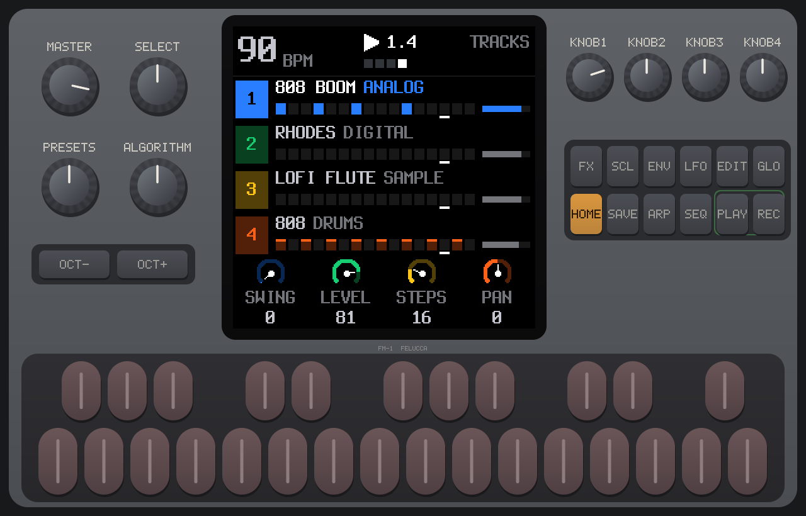<figcaption>The FM-1 running SLOOP 2.7, in fm1-emu. On screen: the TRACKS page, with four tracks playing.</figcaption></figure>

## 1. The one idea: layers

Every function button is a **layer**. **Hold** it, and the **16 white keys** and the four knobs change job. The screen shows those keys as a **4 × 4 grid** (keys 1–4 are the top row, 5–8 the second, and so on). Let go and you're back to playing notes. **Tap** a button to open its pages instead.

| Hold | Screen | The white keys do |
|---|---|---|
| **SEQ** | STEPS | the 16 steps of the selected track |
| **FX** | PUNCH | 27 punch-in effects on the whole mix: loops, stutter, reverse, tape stop, filters… |
| **ARP** | ROLL | note repeat: hold a drum key for a roll |
| **SEL** | KEY | the song's key; the knobs set chords and scale |
| **GLO** | MIX | 1–4 mute, 5–8 solo, 9 fill, 16 tap tempo |
| **EDIT** | ERASE | erase a sound as the loop plays; **EDIT + OCT−** is **undo** |
| **SAVE** | SONG | 1–4 play sections A–D, 5–8 save into them |

**SEL** is the **second button of the top row**, between FX and ENV. Some panel drawings label it SCL. Don't confuse it with the SELECT knob.

**Hands full?** Hold a layer button and tap **HOME** to lock the layer open.

<figure>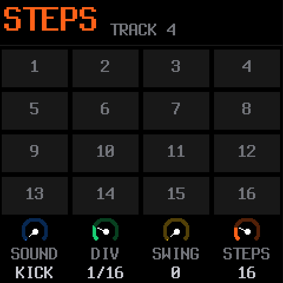<figcaption><b>Hold SEQ</b> → STEPS: the 16 steps as a grid.</figcaption></figure>
<figure>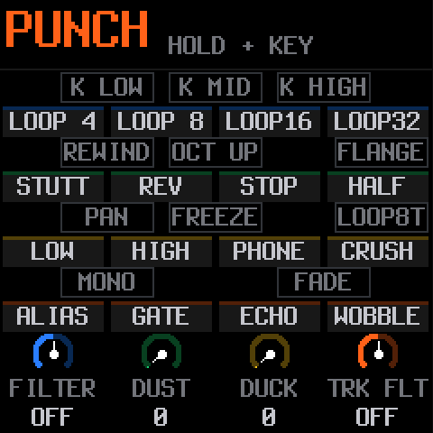<figcaption><b>Hold FX</b> → PUNCH: the effects on the keys.</figcaption></figure>
<figure>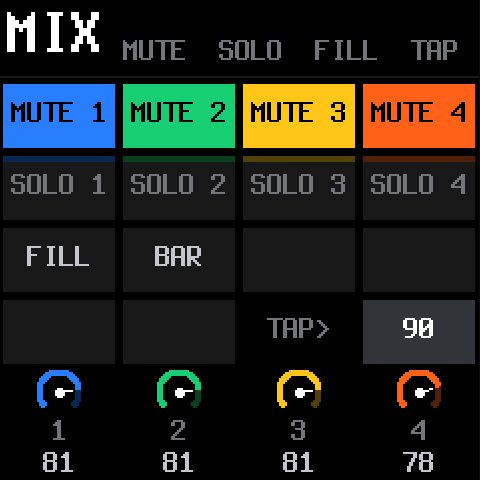<figcaption><b>Hold GLO</b> → MIX: mute, solo, fill, tap.</figcaption></figure>

## 2. The controls

| Control | Does |
|---|---|
| **ALGORITHM** | picks the track: **1 · 2 · 3** synths (blue, green, yellow), **4** drums (orange) |
| **PRESETS** | the track's sound, or on track 4 the **drum kit** (37 kits) |
| **SELECT** | the **tempo** (on the TRACKS page) |
| **PLAY** | starts and stops all four tracks; its light flashes on every beat |
| **REC** | while playing: record now. While stopped: arm. **Hold**: clear the track |
| **OCT− / OCT+** | octave. On the drum track, **hold** them while you hit for **ghost / hard** hits |
| **HOME** | the TRACKS page. **Hold**: the menu |

<figure>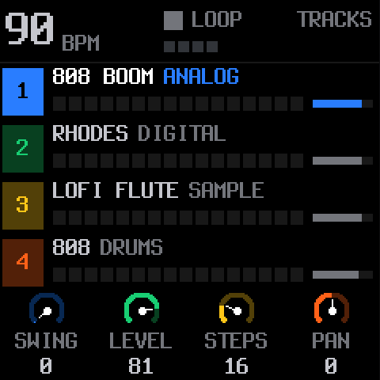<figcaption><b>TRACKS</b>: tempo (90 BPM), the four tracks and their sounds, and the selected track's SWING, LEVEL, STEPS and PAN on the knobs.</figcaption></figure>
<figure>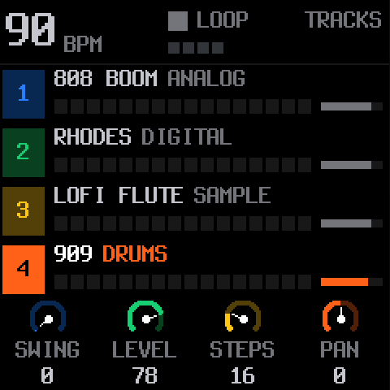<figcaption>ALGORITHM → track 4, then <b>PRESETS</b> → kit 909.</figcaption></figure>

## 3. Your first beat

There are two ways. **Live** is SLOOP's specialty; **steps** is the easy start.

**With steps:**
1. Turn **ALGORITHM** to track **4** (drums), and choose a kit with **PRESETS** (try 808, 909 or BOOMBAP).
2. **Hold SEQ** for STEPS. **KNOB 1 (SOUND)** picks the drum sound: KICK, KICK2, SNARE, CLAP, HAT…
3. With KICK chosen, tap keys **1, 5, 9, 13**. Turn KNOB 1 to **SNARE** and tap **5, 13**. Turn it to **HAT** and tap every other key.
4. Let go of SEQ and press **PLAY**.

**Live, at your own tempo:**
1. On track 4, press **REC** while stopped. The screen says *PLAY A NOTE · IT STARTS THE LOOP*.
2. Play a beat on the white keys (16 drum sounds, kick to cowbell).
3. **Press REC on the "1" after your last bar.** The loop closes, its length sets the tempo, the hits snap to the grid, and it plays straight away.
4. Press **REC** again while it plays to record more on top (overdub).

<figure>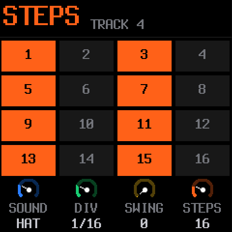<figcaption>STEPS on track 4, SOUND = HAT: hats on every other step.</figcaption></figure>
<figure>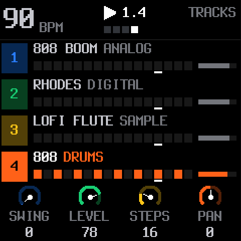<figcaption>PLAY: the drum lane shows the pattern running.</figcaption></figure>
<figure>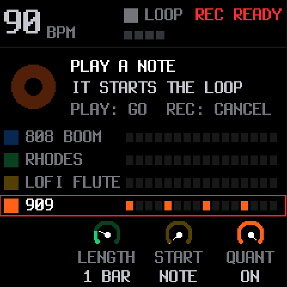<figcaption>REC while stopped: <b>REC READY</b>. LENGTH, START and QUANT are on the knobs.</figcaption></figure>

**Rolls:** hold **ARP** (ROLL) and hold the **HAT** key for a hi-hat roll. **KNOB 1** sets the rate, 1/8 to 1/64. Rolls are recorded as ratchets.

<figure>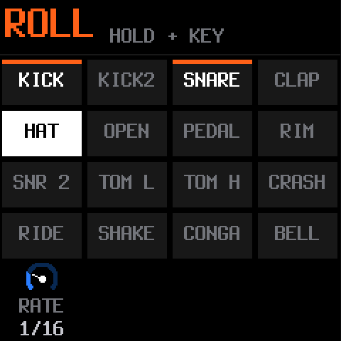<figcaption><b>Hold ARP</b>, hold HAT: a roll at 1/16.</figcaption></figure>

## 4. A bassline

1. Turn **ALGORITHM** to track **1** (blue). The default sound is *808 BOOM*; **PRESETS** browses 153 sounds by kind.
2. While the beat plays, press **REC** and play a bass line on the keys. Notes land where you played them. Press **REC** again to stop recording.
3. Or step it in: **hold SEQ**, choose a **NOTE** with **KNOB 1**, and tap the steps.

<figure>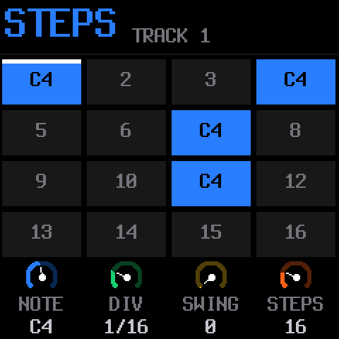<figcaption>STEPS on track 1: KNOB 1 is now <b>NOTE</b> (C4 on steps 1, 4, 7 and 11).</figcaption></figure>
<figure>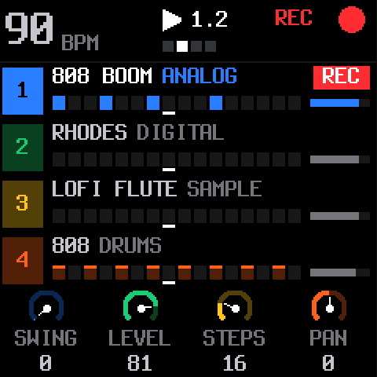<figcaption>REC while playing: <b>REC</b> in red, recording into track 1.</figcaption></figure>
<figure>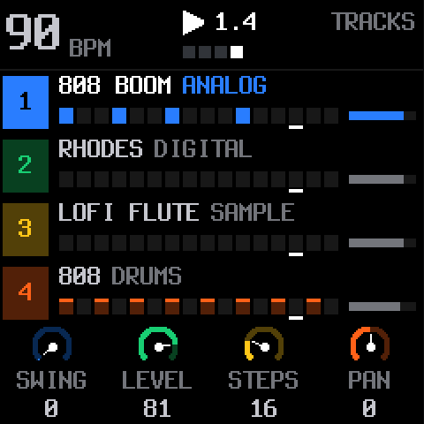<figcaption>Bass and drums together.</figcaption></figure>

## 5. Chords with one finger

1. Turn **ALGORITHM** to track **2** (green, a Rhodes by default).
2. **Hold SEL** (KEY) and press the key of your song, for example **C**.
3. Still holding SEL, turn **KNOB 1 (CHORD)** to **7TH**. Now every white key plays a 7th chord in that key. **KNOB 2** is the scale.

<figure>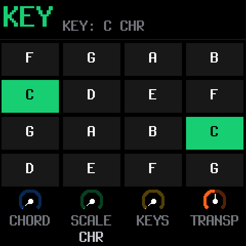<figcaption><b>Hold SEL</b> → KEY: the song's key on the keys.</figcaption></figure>
<figure>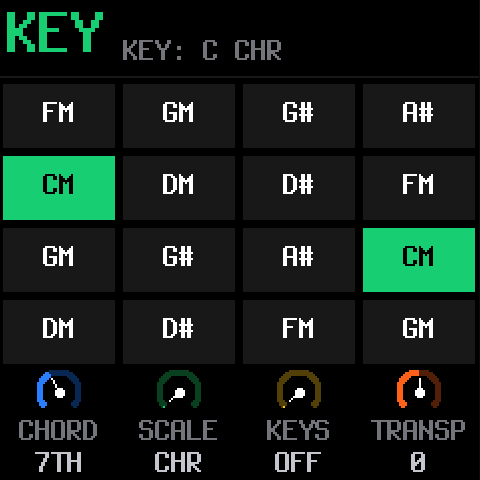<figcaption>CHORD = <b>7TH</b>: each key shows the chord it plays (CM, DM, …).</figcaption></figure>

## 6. Play it live

- **Punch-in effects:** hold **FX** and hold a key. The white keys are loops 1/4–1/32, stutter, reverse, tape stop, half speed, filters, phone and bit crush. The black keys are DJ kills, rewind, octave up, freeze and more. Still holding FX, **KNOB 2 = DUST** (old sampler grit) and **KNOB 3 = DUCK** (the kick pumps the synths).
- **Mute and solo:** hold **GLO** (MIX). Keys **1–4** mute tracks 1–4, **5–8** solo them, **9** plays a fill while held, and **16** taps the tempo.
- **Erase and undo:** hold **EDIT** (ERASE) and press a sound's key to erase it as the loop plays. **EDIT + OCT−** is **undo**, and **EDIT + OCT+** is redo.

<figure>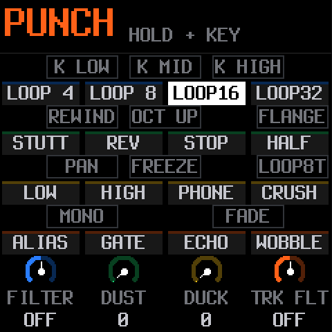<figcaption>FX held, key 3: <b>LOOP16</b> stutters the mix.</figcaption></figure>
<figure>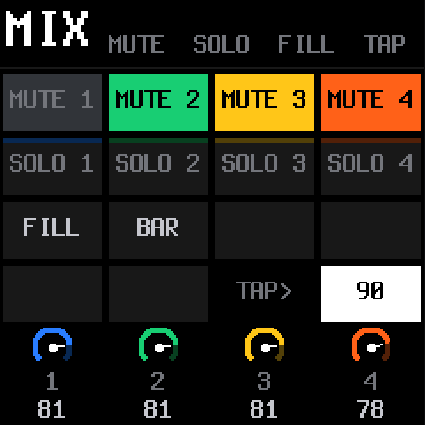<figcaption>GLO held, key 1: track 1 muted (<b>MUTE 1</b> dimmed).</figcaption></figure>
<figure>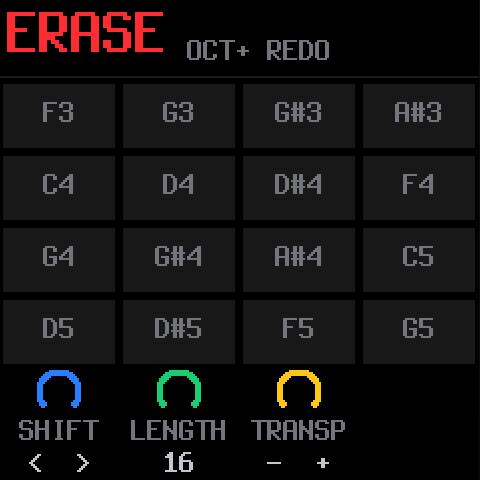<figcaption>EDIT + OCT−: <b>undo</b>. The header now offers OCT+ REDO.</figcaption></figure>

## 7. A song in four sections

SLOOP holds **one song of four sections, A–D**.
1. Make a loop you like, then **hold SAVE** (SONG) and press key **5** (*SAVE A*).
2. Change it, for example by muting the bass or adding a lead, and save into **B** (key 6), and so on.
3. Live: hold **SAVE** and press keys **1–4** to jump to A–D on the next bar. **Keep SAVE held and tap several sections** for a quick chain.
4. Hold SAVE and press key **14** to **record the song as you play it**. Tap **SAVE** on the TRACKS page to edit the song on the **SONG** screen.

<figure>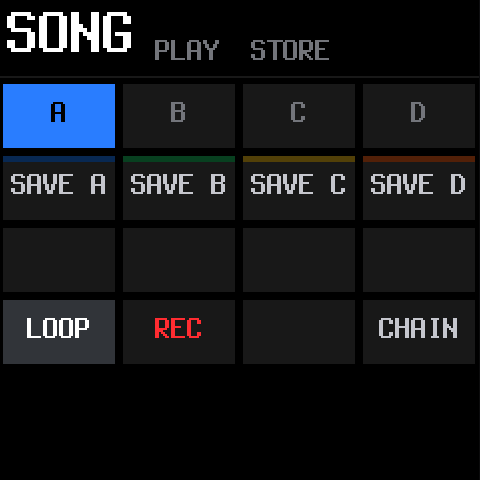<figcaption>SAVE held, key 5: the loop is saved as <b>A</b>.</figcaption></figure>
<figure>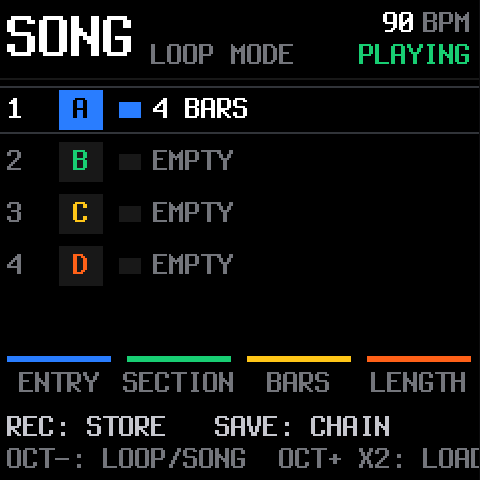<figcaption>The SONG screen: A holds 4 bars, B–D are empty.</figcaption></figure>

**Your work is kept automatically:** stop and leave it for 2.5 s and SLOOP autosaves. At power-on it comes back exactly as you left it. For more songs, keep backups with SLOOP's web editor.

## 8. Settings

**Hold HOME** for the menu: **SCREEN** (colour, zoom, knob speed), **LIGHTS** (glowing buttons and keys for dark stages), **AUDIO** (speaker low cut, USB audio level and rate) and **SYSTEM**. **SELECT** moves between sections, KNOB 1–3 set the rows, and **OCT−** closes.

<figure>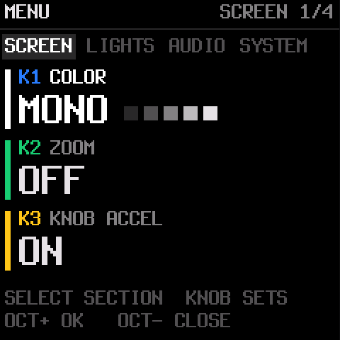<figcaption>Hold HOME: the menu, SCREEN section.</figcaption></figure>

## Felucca or SLOOP?

SLOOP is built on Felucca. They share engines and the update path, but they feel very different:

| | [Felucca](felucca.html) | SLOOP |
|---|---|---|
| Feels like | a multi-engine synth with a deep sequencer | a live groovebox / sampler |
| Tracks | 4, any engine on any track (drums are an engine) | 3 synths + 1 drum track |
| Sounds | 13 engines | 12 synth engines, 153 sounds, 37 drum kits |
| How you work | pages and quick layers; step editing, automation list | hold a button, touch a key; loop recording at your own tempo |
| Sequencer extras | chance, conditions, ratchets, nudge, locks | locks, nudges, fills, ratchets, MPC swing |
| Songs | 16 sections, a lane per track | 4 sections A–D, live chains, record the song as you play |
| Live effects | FX layer on the keys, reverb / echo throws | 27 punch-in effects, DUST, DUCK, a DJ filter |
| Your samples | 3 user slots | 4 slots (~7.4 s each), CHOP in the web editor |

**Pick Felucca** for sound design and arranging, and **SLOOP** for jamming and making beats live. Both are free, so try each in [fm1-emu](https://joakimeriksson.github.io/fm1-emu/?fw=sloop&mhz=100) before flashing.

## Install and go back

- **Install:** the [SLOOP installer](https://isod89.github.io/sloop-fm1/) in Chrome or Edge over USB. From Linux, use the release's `.fwsc` with `fm1_install.py`, the same way as [installing Felucca from Linux](linux-update.html#custom-firmware).
- **Rescue:** if the FM-1 no longer starts SLOOP, hold **OCT−** while switching it on (*SLOOP USB RESCUE*), then install again.
- **Back to stock or to another firmware:** **back up with SLOOP's web editor first**, then install the other firmware. SLOOP's installer has *Return to the official firmware (V15)*.

---

<small>Not affiliated with M-VAVE or isod89. SLOOP is GPL-3.0 software by isod89, based on Felucca by Leo Kuroshita / Hügelton Instruments. The screens are SLOOP 2.7 running in fm1-emu (MIT) by Joakim Eriksson.</small>
